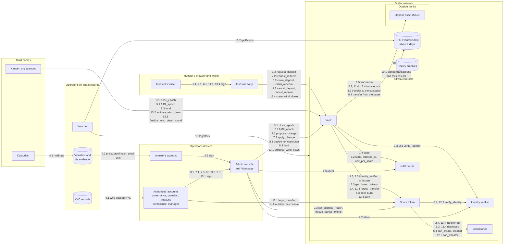

# STRIDE threat model

Strata's threat model in the format of Stellar's
[STRIDE template](https://developers.stellar.org/docs/build/security-docs/threat-modeling/STRIDE-template).
Each issue below points to the threat in [`THREAT_MODEL.md`](./THREAT_MODEL.md)
that holds its full control, residual risk and tests, instead of restating
them. Three issues are about what the whole ledger records or shows rather than
one control; they point to the threat model's Repudiation and Information
disclosure sections. The results of the automated security scan are in
[`SECURITY_SCAN.md`](./SECURITY_SCAN.md).

It covers the code at commit `56b22d1`, whose code is the same as the
`tranche2` tag.

## What are we working on?

Strata is an open-source vault kit on Stellar for real-world assets. Investors
deposit a stablecoin, such as USDC, and receive vault shares. The money is
invested off chain through a custodian, so there is no market price on chain:
an attester posts the value of one share (the NAV) to an oracle. Deposits and
redemptions are requests. They wait in escrow until the open epoch is sealed and
then priced with a report accepted after the seal. Then each holder claims their
shares or their cash.

On chain, the kit has five contracts:

- **Vault** (`async-vault`): requests, epochs, pricing, the cash reserve,
  claims, the timelock for admin changes, and the wind-down.
- **Share token** (`share-token`): an OpenZeppelin RWA token. Mints and
  transfers between holders are checked against the identity verifier and the
  compliance contract. The vault's escrow moves (`forced_transfer`) skip those
  checks; the vault checks the holder itself.
- **NAV oracle** (`nav-oracle`): stores the latest report and refuses one
  outside the price band, beyond the maximum move, inside the cooldown or
  already expired.
- **Identity verifier** and **compliance** (`identity-verifier`, `compliance`):
  decide which accounts may hold and move shares. Both are testnet stubs.

Off chain, the kit ships one static web app with no backend. Its investor dApp
offers the investor's requests, cancellations and claims, the wind-down claim
included. Its admin console offers the privileged calls and the `/sign` page
where an authority's signers collect signatures. Both read the contracts through
a Stellar RPC. The authorities (governance, guardian, treasury, attester,
compliance) are meant to be Stellar multisig accounts; the manager is a role.
The custodian, the valuation behind each report, the KYC behind the allowlist
and any watcher are the operator's. A keeper is any account that makes the calls
anyone may make, such as pricing an epoch.

### Data flow diagram

Each box with a title is a trust boundary. Every arrow carries the step numbers
of the flows below and the call it makes. Transactions and reads go through a
Stellar RPC; the diagram draws them from the caller to the contract.

What crossing each boundary means:

- **Investor's browser and wallet.** Anything the dApp builds is checked by the
  contracts; the dApp holds no key and no secret. The investor's signature
  proves the holder (X14).
- **Operator's devices.** The console builds privileged calls and the `/sign`
  page shows them before a signer approves (R12, R13). Each authority's
  signature proves the role holder (R4).
- **Operator's off-chain records.** The valuation, its evidence and the KYC
  records never reach the chain. Only a proof hash, an optional proof URI and a
  yes or no per address do (O10, R9).
- **Third parties.** The custodian and any keeper are outside the operator's
  control. A keeper can only make the calls anyone may make. The custodian
  holds the deployed capital off chain.
- **Strata contracts.** The contracts check every call themselves. They trust
  the host's signature checks and the contracts at the addresses governance set
  (the oracle, the verifier, the compliance contract).
- **Outside the kit.** The deposit asset's issuer can freeze or claw back the
  vault's cash (X10).

### Data entities

| Entity | Where | Who writes it |
| --- | --- | --- |
| Deposit and redemption requests, epochs, positions, wind-down credits, running totals | Vault storage | Holders' and anyone's calls; pricing |
| Queued admin changes and their ETAs | Vault, share token, oracle and compliance storage | Governance |
| Share balances and frozen shares | Share token storage | The vault (mint, burn, forced transfer); compliance (freezes, and legal transfers with governance) |
| The latest report: price, times, proof hash and URI | Oracle storage | The attester |
| Allowlist entries: yes or no per address | Identity verifier storage | Compliance |
| Compliance modules and bound tokens | Compliance storage | Governance |
| The deposit asset's balances | The asset's contract (SAC) | Transfers; the issuer |
| Events | An RPC's window, about seven days | Each contract |
| Signed transactions and their results | The network's history archives | The network |
| Valuation evidence, KYC records | Operator, off chain | Attester, compliance |

### Flows

Each step is numbered so a threat can cite it.

1. **Deposit request.**
   1. The investor signs `request_deposit(holder, amount)` in their wallet.
   2. The dApp sends it to the vault.
   3. The vault reads the token's verifier (`identity_verifier`) and checks the
      holder with it (`verify_identity`).
   4. The vault checks that the oracle answers `Valid` (`state`).
   5. The vault moves `amount` of the deposit asset from the holder into escrow
      (`transfer`) and publishes `DepositRequested`.
2. **Redemption request.**
   1. The investor signs `request_redeem(holder, shares)`.
   2. The dApp sends it to the vault.
   3. The vault checks the holder's standing (`verify_identity`, `is_frozen`)
      and their frozen shares (`get_frozen_tokens`).
   4. The vault moves the shares into its escrow (`forced_transfer`), which the
      token reports to the compliance contract (`transferred`), and publishes
      `RedeemRequested`.
3. **Epoch close.**
   1. The manager, or anyone once the open epoch has run the minimum epoch
      duration, calls `close_epoch(caller)`. The vault seals the epoch, opens
      the next and publishes `EpochClosed`. The notice starts.
4. **Attest.**
   1. The custodian reports the fund's holdings to the attester, off chain.
   2. The attester values the fund, keeps the evidence and hashes it.
   3. The attester's account signs `attest(input, caller)` through the console.
   4. The oracle checks the band, the maximum move, the cooldown and the expiry,
      stamps the time it accepted the report and publishes `NavAttested`.
5. **Fulfil.**
   1. Once the notice ends, anyone calls `fulfill_epoch(epoch_id)`.
   2. The vault reads the oracle (`state`, `attested_at`, `nav_per_share`) and
      refuses a report accepted before the seal.
   3. The vault fixes the shares and the cash each side is owed, and publishes
      `EpochFulfilled`.
6. **Claim.**
   1. The investor signs `claim_deposit` or `claim_redeem`.
   2. The dApp sends it to the vault.
   3. For a deposit, the vault mints the shares to the holder (`mint`). For a
      redemption, it pays the cash (`transfer`) and burns the escrowed shares
      (`burn`), which the token reports to the compliance contract
      (`destroyed`).
   4. On a mint, the share token checks the holder with the identity verifier
      and the compliance contract (`verify_identity`, `can_create`), then
      reports the mint (`created`).
7. **Timelocked admin change.**
   1. Governance's signers sign `propose_change(change)` through the console's
      `/sign` page.
   2. The vault queues the change with its ETA and publishes `ChangeProposed`.
   3. After the delay, governance signs `apply_change(id)`. The vault checks the
      change again, applies it and publishes `ChangeApplied`. A code change
      replaces the contract's code with `update_current_contract_wasm`.
8. **Capital to and from the custodian.**
   1. The treasury calls `deploy_to_custodian(caller, assets)`.
   2. The vault sends free reserve to the custodian (`transfer`) and publishes
      `Deployed`.
   3. Cash comes back through `fund(caller, assets)`, which anyone may call; the
      vault takes it from the payer (`transfer`) and publishes `Funded`.
9. **Allowlist and freeze.**
   1. Compliance checks an investor's KYC, off chain.
   2. Compliance signs `allow(account, allowed)` on the identity verifier.
   3. Compliance freezes or unfreezes an address or part of its shares on the
      share token (`set_address_frozen`, `freeze_partial_tokens`).
10. **Monitoring.**
    1. Each contract publishes events, which an RPC serves for about seven
       days; the network keeps every signed transaction and its result.
    2. A watcher reads the events (`getEvents`) and the contracts' getters, and
       stores them.
11. **Cancellation.**
    1. The investor signs `cancel_deposit` or `cancel_redeem`.
    2. The dApp sends it to the vault.
    3. The vault checks that the request can still be cancelled: its epoch is
       open, or sealed but no longer priceable, or a wind-down is active.
    4. The vault returns the escrowed cash (`transfer`) or shares
       (`forced_transfer`, reported to the compliance contract as
       `transferred`), and publishes `DepositCancelled` or `RedeemCancelled`.
12. **Legal transfer.**
    1. Compliance and governance sign one `legal_transfer` call, built outside
       the console.
    2. The share token checks that the two signers are different accounts, that
       neither side is the vault and that the destination passes the identity
       check (`verify_identity`, `can_transfer`), moves the shares and
       publishes `LegalTransfer`.
13. **Wind-down.**
    1. Governance signs `propose_wind_down` through the console; it waits its
       own delay, 7 to 90 days.
    2. Once it is due, anyone calls `activate_wind_down`.
    3. The treasury returns capital (`fund`), and anyone calls
       `finalize_wind_down_round` to credit holders.
    4. Each holder signs `claim_wind_down`; the vault burns the shares the
       holder gives up (`burn`, reported as `destroyed`) and pays the cash
       (`transfer`).

## What can go wrong?

### STRIDE reminders

| Mnemonic Threat | Definition | Question |
| --- | --- | --- |
| **S**poofing | The ability to impersonate another user or system component to gain unauthorized access. | Is the user who they say they are? |
| **T**ampering | Unauthorized alteration of data or code. | Has the data or code been modified in some way? |
| **R**epudiation | The ability for a system or user to deny having taken a certain action. | Is there enough data to “prove” the user took the action if they were to deny it? |
| **I**nformation Disclosure | The over-sharing of data expected to be kept private. | Is there anywhere where excessive data is being shared or controls are not properly in place to protect private information? |
| **D**enial of Service | The ability for an attacker to negatively affect the availability of a system. | Can someone, without authorization, impact the availability of the service or business? |
| **E**levation of Privilege | The ability for an attacker to gain additional privileges and roles beyond what they initially were granted. | Are there ways for a user, without proper authentication (verifying identity) and authorization (verifying permission) to gain access to additional privileges, either through standard (normally legitimate) or illegitimate means? |

### Threat table

Each issue names the attacker (or says that none is needed), the step it
targets and what it breaks, then the threat in `THREAT_MODEL.md` that treats it.

| Threat | Issues |
| --- | --- |
| **S**poofing | **Spoof.1** - Someone with enough of an authority's keys to reach its threshold signs as that authority (steps 3.1, 4.3, 7.1, 8.1, 9.2, 13.1) and gets every power it holds. [R4](./THREAT_MODEL.md#r4-an-authoritys-keys)   **Spoof.2** - Someone who hosts a copy of the console, or crafts a `/sign` link, shows an authority one call and gets it to sign another (steps 4.3, 7.1, 9.2). [R12](./THREAT_MODEL.md#r12-a-crafted-transaction-on-the-consoles-signing-page)   **Spoof.3** - A compliance key lists an address that never passed KYC, or governance swaps in a verifier that answers yes for anyone (steps 9.2, 1.3, 6.4), so an unverified account holds shares. [R9](./THREAT_MODEL.md#r9-compliance-compromised), [R11](./THREAT_MODEL.md#r11-swapping-the-tokens-compliance-contract-or-verifier), [X4](./THREAT_MODEL.md#x4-a-delisted-holder)   **Spoof.4** - Governance swaps in an oracle it controls (step 7.3), and the vault prices epochs from it as if it were the real feed (step 5.2). [O9](./THREAT_MODEL.md#o9-governance-changes-the-limits-or-the-feed)   **Spoof.5** - Any account requests, cancels or claims in a holder's name (steps 1.2, 2.2, 6.2, 11.2, 13.4) to move the holder's escrow or take their payout. [X14](./THREAT_MODEL.md#x14-a-call-made-in-a-holders-name) |
| **T**ampering | **Tamper.1** - A compromised or careless attester posts a false price inside the limits, or walks the price in steps (step 4.3), and every request priced from it gets the wrong price. [O1](./THREAT_MODEL.md#o1-one-false-report-within-the-limits), [O2](./THREAT_MODEL.md#o2-a-walk-of-reports)   **Tamper.2** - The attester posts a report whose evidence is missing or does not support the price (steps 4.2, 4.3). [O10](./THREAT_MODEL.md#o10-the-proof-proves-nothing-on-chain)   **Tamper.3** - The attester gives a report a far expiry or a valuation made before the seal, or a holder acting as keeper waits to fulfil until a report suits them (steps 4.3, 5.1), to favour some holders over others. [O5](./THREAT_MODEL.md#o5-time-games), [O13](./THREAT_MODEL.md#o13-choosing-which-report-prices-an-epoch)   **Tamper.4** - Someone with governance's keys changes code, roles or wiring (steps 7.1 to 7.3). [R1](./THREAT_MODEL.md#r1-governance-compromised-the-changes-that-wait), [R11](./THREAT_MODEL.md#r11-swapping-the-tokens-compliance-contract-or-verifier)   **Tamper.5** - A holder uses rounding to take more than their share (steps 1.5, 5.3, 6.3). [X9](./THREAT_MODEL.md#x9-rounding-and-amounts-below-one-share)   **Tamper.6** - Compliance and governance together move a holder's wallet shares (step 12.1). [R10](./THREAT_MODEL.md#r10-compliance-and-governance-move-a-holders-shares-together) |
| **R**epudiation | **Repudiate.1** - Compliance lists or delists an address and later denies it; the verifier stub publishes no event (step 9.2). [R14](./THREAT_MODEL.md#r14-an-allowlist-change-that-publishes-no-event)   **Repudiate.2** - The attester denies what a report was based on (steps 4.2, 4.3). [O10](./THREAT_MODEL.md#o10-the-proof-proves-nothing-on-chain)   **Repudiate.3** - An authority denies a privileged act once the RPC has dropped its events, about seven days later (step 10.1). [Repudiation](./THREAT_MODEL.md#repudiation)   **Repudiate.4** - An authority changes its own signers or thresholds and later denies it. This is an operation on its Stellar account, outside the flows, and publishes no contract event. [Repudiation](./THREAT_MODEL.md#repudiation) |
| **I**nformation Disclosure | **Info.1** - Anyone who links an address to a person reads that person's position, requests and history, and sees that they passed KYC (contract storage and events, step 10.1). [Information disclosure](./THREAT_MODEL.md#information-disclosure)   **Info.2** - Someone who sees a `/sign` link reads a freeze or a price before it lands (steps 4.3, 9.3), so a holder collects or moves value first. [R13](./THREAT_MODEL.md#r13-a-signing-link-read-before-the-call-lands)   **Info.3** - A holder reads a sealed epoch's price and cancels if it does not suit them (steps 5.2, 11.3). [O6](./THREAT_MODEL.md#o6-declining-a-price-after-seeing-it)   **Info.4** - Anyone who reads a report fetches the evidence at its proof URI, which the operator meant to keep private (step 4.3). [Information disclosure](./THREAT_MODEL.md#information-disclosure) |
| **D**enial of Service | **DoS.1** - The attester stops reporting, or a compromised guardian pauses the NAV or the vault again and again (steps 4.3, 5.2), so no epoch is priced. [O4](./THREAT_MODEL.md#o4-the-feed-goes-stale), [O7](./THREAT_MODEL.md#o7-the-nav-pause-used-to-stall-pricing), [R6](./THREAT_MODEL.md#r6-guardian-compromised)   **DoS.2** - A loss at the custodian leaves priced exits owing more cash than the vault holds, or the deposit asset's issuer freezes or claws back the vault's cash (steps 6.3, 13.4), so claims wait. [X1](./THREAT_MODEL.md#x1-the-reserve-cannot-pay-a-priced-exit), [X10](./THREAT_MODEL.md#x10-the-deposit-assets-issuer-freezes-or-claws-back-the-vaults-cash)   **DoS.3** - A compliance module refuses or fails, or governance installs one that does, so escrow moves, mints and burns fail (steps 2.4, 6.3, 6.4, 11.4). [X6](./THREAT_MODEL.md#x6-a-compliance-module-blocks-exits)   **DoS.4** - The manager stops sealing (step 3.1), so requests wait. [R8](./THREAT_MODEL.md#r8-the-manager-stops-sealing-or-picks-the-moment)   **DoS.5** - No attacker is needed: a deposit worth less than one share whose refund can only come from the epoch's own rounding dust, or a zero-asset redemption whose holder is delisted before claiming, stays stuck because its epoch never reconciles (steps 6.2, 6.3). [X4](./THREAT_MODEL.md#x4-a-delisted-holder), [#434](https://github.com/BootNodeDev/strata-vault-kit/issues/434), [#445](https://github.com/BootNodeDev/strata-vault-kit/issues/445)   **DoS.6** - No attacker is needed: when a report expires inside its cooldown, the attester cannot post a fresh one until the cooldown ends (step 4.4), so pricing waits. [O4](./THREAT_MODEL.md#o4-the-feed-goes-stale), [#435](https://github.com/BootNodeDev/strata-vault-kit/issues/435)   **DoS.7** - An idle contract's storage archives, anyone files many requests to push calls past a transaction's limits, or an upgrade cannot read what the old code stored (any step), so calls fail. [X11](./THREAT_MODEL.md#x11-storage-that-expires), [X12](./THREAT_MODEL.md#x12-resource-limits-contention-and-griefing), [X13](./THREAT_MODEL.md#x13-an-upgrade-cannot-read-what-the-vault-stored) |
| **E**levation of Privilege | **Elevation.1** - Someone with governance's keys upgrades a contract, grants roles or swaps the oracle, verifier or rules (steps 7.1 to 7.3), or uses the powers that act at once. [R1](./THREAT_MODEL.md#r1-governance-compromised-the-changes-that-wait), [R2](./THREAT_MODEL.md#r2-governance-compromised-the-powers-that-act-at-once)   **Elevation.2** - A deployer opens deposits while admin changes are still instant, or with a binding missing (before step 1.2). [R3](./THREAT_MODEL.md#r3-setup-left-open-or-wired-wrong)   **Elevation.3** - Someone who takes one key that holds several roles reaches several powers (grants at step 7.3). [R5](./THREAT_MODEL.md#r5-one-account-in-several-seats)   **Elevation.4** - Someone with a guardian or treasury key tries to reach past its role: moving funds, or draining the reserve (step 8.1). [R6](./THREAT_MODEL.md#r6-guardian-compromised), [R7](./THREAT_MODEL.md#r7-treasury-compromised) |

## What are we going to do about it?

Each remediation is **In place** (with the code or test that shows it),
**Recommended** (not built or not run yet), or **Accepted** (with the reason and
the risk that remains). The threat each issue points to lists every test.

| Threat | Issues |
| --- | --- |
| **S**poofing | **Spoof.1.R.1** - In place: each privileged call checks the role, asks that account for exactly one signature, and the network checks it against the account's signers and thresholds. Test: `each_admin_call_after_setup_asks_the_admin_for_one_signature` ([R4](./THREAT_MODEL.md#r4-an-authoritys-keys)).   **Spoof.1.R.2** - Recommended: make each authority a Stellar multisig account with keys held by different people, and read its signers and thresholds on the network before going live (IP.1).   **Spoof.1.R.3** - In place: after setup, code, roles and wiring change only through the timelock, so holders see a takeover's changes days before they land. Test: `applying_before_the_eta_is_refused` ([R1](./THREAT_MODEL.md#r1-governance-compromised-the-changes-that-wait)).   **Spoof.2.R.1** - In place: the `/sign` page decodes the transaction and refuses anything it cannot show in full: a fee bump, a second operation, another contract, an operation the console does not offer, arguments of the wrong shape. Test: "refuses a contract that is not one of the configured four" ([R12](./THREAT_MODEL.md#r12-a-crafted-transaction-on-the-consoles-signing-page)).   **Spoof.2.R.2** - Accepted, because the kit cannot control who serves a web page: a console hosted by someone else can show anything. Each operator hosts its own, and each signer reads the call in their wallet. Remaining risk: a signer who signs without reading.   **Spoof.3.R.1** - In place: only the verifier's admin (compliance) lists, and the vault checks the verifier before any cash moves. Test: `an_investor_who_was_never_allowlisted_is_refused_before_any_cash_moves` ([X4](./THREAT_MODEL.md#x4-a-delisted-holder)).   **Spoof.3.R.2** - In place: a verifier or rules swap waits for the timelock after setup, and a new verifier must accept the vault. Tests: `rule_and_verifier_swaps_wait_after_setup`, `a_verifier_that_stops_accepting_the_vault_is_never_installed` ([R11](./THREAT_MODEL.md#r11-swapping-the-tokens-compliance-contract-or-verifier)).   **Spoof.3.R.3** - Accepted, because the chain cannot check a person's identity: the KYC behind each listing is the operator's, and the kit's verifier is a testnet stub. Remaining risk: a careless or compromised compliance key lists the wrong address, and governance can install a verifier that accepts anyone, which holders see during the delay. Mainnet's registry is chosen in [#238](https://github.com/BootNodeDev/strata-vault-kit/issues/238).   **Spoof.4.R.1** - In place: an oracle swap waits for the timelock, and the new oracle must name this vault, have finished its setup and answer `state()` and `freshness_duration()` (`feed_bound_here_and_answering` in [`guards.rs`](../contracts/async-vault/src/guards.rs)). Tests: [O9](./THREAT_MODEL.md#o9-governance-changes-the-limits-or-the-feed).   **Spoof.4.R.2** - Recommended: alert on every proposed change ([monitoring plan P6](./MONITORING_PLAN.md#p6-change-proposed-to-the-timelock)), so holders can leave during the delay.   **Spoof.4.R.3** - Accepted, because the checks can catch wiring mistakes, not intent. Remaining risk: a contract governance writes can pass them and report any price; the delay is notice, not a guaranteed exit.   **Spoof.5.R.1** - In place: each request, cancellation and claim asks the named holder to sign, the vault has no operators, and a claim pays the holder. Tests: `request_deposit_needs_the_investor_authorisation`, `cancel_redeem_asks_the_holder_for_one_signature` ([X14](./THREAT_MODEL.md#x14-a-call-made-in-a-holders-name)). |
| **T**ampering | **Tamper.1.R.1** - In place: a report must sit in the band, move by no more than the maximum, come after the cooldown and carry its own expiry; the oracle stamps the time it took it. The guardian can pause the NAV and governance revokes the attester at once. Test: `attest_enforces_cooldown_and_deviation` ([O1](./THREAT_MODEL.md#o1-one-false-report-within-the-limits)); Certora proved the band, the maximum move, the cooldown and the config check ([scan](./SECURITY_SCAN.md#certora-sunbeam)).   **Tamper.1.R.2** - Recommended: make the attester a multisig, and alert on large moves and runs of reports one way ([monitoring plan V4](./MONITORING_PLAN.md#v4-a-large-step), [V5](./MONITORING_PLAN.md#v5-a-run-of-reports-one-way)).   **Tamper.1.R.3** - Accepted, because the chain cannot know the fund's true value; the limits bound how far each report moves it. Remaining risk: value moves between the holders who enter or leave in that epoch and those who stay.   **Tamper.2.R.1** - In place: each report must carry a proof hash that is not all zeros, and may carry a URI. Test: `a_report_without_a_proof_hash_is_refused` ([O10](./THREAT_MODEL.md#o10-the-proof-proves-nothing-on-chain)).   **Tamper.2.R.2** - Recommended: a reviewer fetches each report's evidence and compares its hash; the chain cannot check the evidence (IP.3).   **Tamper.3.R.1** - In place: only a report accepted at or after the seal prices an epoch, the oracle cuts a far expiry to its freshness window, and the cooldown and caps limit which reports can land before someone fulfils. Tests: `an_epoch_is_not_priced_against_a_valuation_older_than_its_close` ([O5](./THREAT_MODEL.md#o5-time-games)), `an_epoch_cannot_be_priced_inside_its_notice` ([O13](./THREAT_MODEL.md#o13-choosing-which-report-prices-an-epoch)).   **Tamper.3.R.2** - Recommended: run a keeper that fulfils each epoch as soon as its notice ends, so no one can wait for a better report ([scan finding A4](./SECURITY_SCAN.md#almanax)).   **Tamper.3.R.3** - Accepted, because the chain sees when a report was accepted, not when its valuation was made. Remaining risk: a report accepted after the seal can carry a valuation made before it (O5).   **Tamper.4.R.1** - In place: after setup, code and wiring changes wait at least seven days on the vault's timelock, are checked again when applied, and wait longer while the vault is paused; during a wind-down nothing lands except a grant of the token's `compliance` role. Tests: `applying_before_the_eta_is_refused`, `a_pause_freezes_the_upgrade_timelock_clock`, `nothing_timelocked_moves_during_a_wind_down_a_manager_revoke_included` ([R1](./THREAT_MODEL.md#r1-governance-compromised-the-changes-that-wait)).   **Tamper.5.R.1** - In place: conversions round down in the vault's favour and each claim rounds on its own. Test: `deposit_and_redeem_round_trip_never_manufactures_assets` ([X9](./THREAT_MODEL.md#x9-rounding-and-amounts-below-one-share)); Certora proved the deposit and redemption floors and that a round trip never gains ([scan](./SECURITY_SCAN.md#certora-sunbeam)).   **Tamper.6.R.1** - In place: a legal transfer needs compliance and governance in the same call, from two different accounts, to a destination that passes the identity check, and never moves shares out of or into the vault's address. Tests: `compliance_and_the_admin_move_shares_together`, `one_account_cannot_co_sign_with_itself`, `the_destination_must_pass_the_identity_check`, `nothing_leaves_the_vault_address` ([R10](./THREAT_MODEL.md#r10-compliance-and-governance-move-a-holders-shares-together)).   **Tamper.6.R.2** - Accepted, because moving shares on a legal order is a power the fund needs, and the kit splits it between two authorities. Remaining risk: both keys taken, or both acting wrongly; and governance can grant `compliance` to an account it controls after one delay, a wind-down included, and reach both signatures alone. |
| **R**epudiation | **Repudiate.1.R.1** - Recommended: make `allow` publish an event with the account and its new answer ([#441](https://github.com/BootNodeDev/strata-vault-kit/issues/441)).   **Repudiate.1.R.2** - Accepted until then, because the verifier is a testnet stub and a production registry publishes its own events. Remaining risk: a watcher that reads events misses every listing; `is_allowed` shows the current answer, and the signed transaction stays in the history archives ([R14](./THREAT_MODEL.md#r14-an-allowlist-change-that-publishes-no-event)).   **Repudiate.2.R.1** - In place: each report's proof hash ties it to its evidence, and `NavAttested` publishes it. Test: `attesting_publishes_the_stored_valuation` ([Repudiation](./THREAT_MODEL.md#repudiation)).   **Repudiate.2.R.2** - Recommended: the operator keeps each report's evidence for as long as the fund's records must be kept (IP.3).   **Repudiate.3.R.1** - In place: every privileged call that changes state publishes an event, except `allow` (Repudiate.1), and the transaction carries each signer's signature. Test: `proposing_and_applying_publish_the_change` on the vault, the token, the oracle and the compliance contract. Several of the kit's own privileged events, such as `Deployed` and `NavPausedSet`, have no test yet ([Repudiation](./THREAT_MODEL.md#repudiation)).   **Repudiate.3.R.2** - Recommended: run a watcher that stores each event as it reads it, inside the RPC's window ([monitoring plan](./MONITORING_PLAN.md#how-events-are-read-and-kept)); history beyond it is in the archives (IP.6).   **Repudiate.4.R.1** - Recommended: watch each authority's account through an account-history service ([monitoring plan](./MONITORING_PLAN.md#what-this-plan-does-not-cover)). |
| **I**nformation Disclosure | **Info.1.R.1** - Accepted, because the ledger is public on purpose: anyone can check the books without trusting the operator. Remaining risk: a holder who needs more privacy than a public ledger gives cannot get it from the kit.   **Info.1.R.2** - In place: the KYC data stays off chain; the kit's verifier stores only a yes or no per address (`allow` in [`identity-verifier/src/lib.rs`](../contracts/identity-verifier/src/lib.rs)).   **Info.2.R.1** - In place: the console puts the transaction after the link's `#`, which the browser does not send to its host, and the transaction expires seven days after it is built. Test: "sends an expired link back to the proposer without a share row" ([R13](./THREAT_MODEL.md#r13-a-signing-link-read-before-the-call-lands)).   **Info.2.R.2** - Recommended: signers share a link only with their co-signers, over a private channel, and the attester builds a report's transaction after the epoch is sealed.   **Info.3.R.1** - In place: once a sealed epoch's price is readable, cancellation closes. Test: `a_sealed_epoch_cannot_be_cancelled_while_it_can_be_priced` ([O6](./THREAT_MODEL.md#o6-declining-a-price-after-seeing-it)).   **Info.4.R.1** - Recommended: when the evidence is private, publish the hash alone (an empty URI) and give the evidence to whoever checks it ([O10](./THREAT_MODEL.md#o10-the-proof-proves-nothing-on-chain)). |
| **D**enial of Service | **DoS.1.R.1** - In place: when pricing stalls, sealed epochs reopen to cancellation, so escrow is never stuck behind the feed; only governance lifts a pause, and it can replace the guardian. Tests: `a_sealed_epoch_cancels_once_the_feed_goes_stale` ([X7](./THREAT_MODEL.md#x7-escrow-behind-stalled-pricing)), `the_guardian_pauses_the_nav_but_unpausing_needs_governance` ([O7](./THREAT_MODEL.md#o7-the-nav-pause-used-to-stall-pricing)).   **DoS.1.R.2** - Recommended: alert before a report expires and on every pause ([monitoring plan V1](./MONITORING_PLAN.md#v1-report-close-to-expiry), [P2](./MONITORING_PLAN.md#p2-nav-paused-or-lifted)).   **DoS.2.R.1** - In place: a claim pays when the reserve covers it, in any order; nothing goes to the custodian while anything is uncovered; after a clawback the vault refuses by name the cancellations, claims and deposits its balance cannot cover. Tests: `a_covered_claim_pays_while_a_larger_one_waits` ([X1](./THREAT_MODEL.md#x1-the-reserve-cannot-pay-a-priced-exit)), `a_cancellation_the_balance_cannot_cover_is_refused_by_name` ([X10](./THREAT_MODEL.md#x10-the-deposit-assets-issuer-freezes-or-claws-back-the-vaults-cash)).   **DoS.2.R.2** - Recommended: check the deposit asset's issuer flags before going live (IP.2).   **DoS.2.R.3** - Accepted, because the issuer's controls are outside the kit. Remaining risk: a freeze makes every cash exit fail inside the asset until it lifts, and in a wind-down a claim checks no coverage, so after a loss of reserve it can take deposit escrow ([Known limits](./THREAT_MODEL.md#known-limits)).   **DoS.3.R.1** - Accepted, because a module change must not land unannounced: removing a faulty module waits for the timelock, like adding one ([Known limits](./THREAT_MODEL.md#known-limits)). Remaining risk: exits wait that long, and a module that fails during a wind-down cannot be removed until [#437](https://github.com/BootNodeDev/strata-vault-kit/issues/437) lands.   **DoS.4.R.1** - In place: once governance has set a minimum epoch duration, anyone may seal an epoch that has run it. Test: `an_outsider_seals_once_the_minimum_has_run` ([R8](./THREAT_MODEL.md#r8-the-manager-stops-sealing-or-picks-the-moment)). With none set, exits at a price wait until governance replaces the manager.   **DoS.4.R.2** - Recommended: set a minimum epoch duration at deploy; [#436](https://github.com/BootNodeDev/strata-vault-kit/issues/436) flags a vault that closed setup without one.   **DoS.5.R.1** - Recommended: fix [#434](https://github.com/BootNodeDev/strata-vault-kit/issues/434) and [#445](https://github.com/BootNodeDev/strata-vault-kit/issues/445) in one change, so every request in an epoch can settle and the epoch reconciles.   **DoS.6.R.1** - Recommended: fix [#435](https://github.com/BootNodeDev/strata-vault-kit/issues/435), so a fresh report can replace an expired one inside the cooldown.   **DoS.7.R.1** - In place: every read and write extends the entry's lifetime. Test: `any_vault_read_restores_the_instance_ttl` ([X11](./THREAT_MODEL.md#x11-storage-that-expires)). Pricing and wind-down rounds read running totals, so their cost does not grow with the number of requests; no test measures it yet (IP.8).   **DoS.7.R.2** - Recommended: measure the cost of each call and contention in one ledger (IP.8).   **DoS.7.R.3** - Accepted, because no release changes a stored type yet. Remaining risk: the first release that does needs a test that upgrades over entries of the old shape ([X13](./THREAT_MODEL.md#x13-an-upgrade-cannot-read-what-the-vault-stored)). |
| **E**levation of Privilege | **Elevation.1.R.1** - In place: after setup, upgrades, grants and swaps wait for the timelock (Tamper.4.R.1).   **Elevation.1.R.2** - Accepted, because pauses, revocations and the deposit cap must act at once in an emergency. Remaining risk, from R2: with an attester, governance can set any price in the band at once, and with compliance it can move any holder's wallet shares at once.   **Elevation.1.R.3** - Recommended: governance as a multisig (Spoof.1.R.2), and an alert on every proposed and applied change ([monitoring plan P6](./MONITORING_PLAN.md#p6-change-proposed-to-the-timelock)).   **Elevation.2.R.1** - In place: the vault takes no request and moves no epoch until `finish_setup`, which refuses until every wiring check holds and its books are empty. Test: `a_deposit_before_setup_finishes_is_refused` ([R3](./THREAT_MODEL.md#r3-setup-left-open-or-wired-wrong)).   **Elevation.3.R.1** - In place: the vault's constructor refuses four pairs of equal addresses. Test: `the_treasury_may_not_also_be_governance` ([R5](./THREAT_MODEL.md#r5-one-account-in-several-seats)).   **Elevation.3.R.2** - Accepted, because the role checks are being redesigned so a deployment may choose to run every role from one key. Remaining risk: later grants and the other contracts' roles are not checked, and two accounts can share a signer; holders read each contract's role holders ([Known limits](./THREAT_MODEL.md#known-limits)).   **Elevation.4.R.1** - In place: the guardian can pause but not move funds, and the treasury moves only free reserve, only to the custodian, never while anything is uncovered. Tests: `the_guardian_pauses_but_only_governance_unpauses` ([R6](./THREAT_MODEL.md#r6-guardian-compromised)), `assets_owed_to_a_priced_redemption_cannot_be_deployed` ([R7](./THREAT_MODEL.md#r7-treasury-compromised)). |

### Soroban checks

| Check | Answer |
| --- | --- |
| `overflow-checks` in the release profile | On: `overflow-checks = true` in the workspace's [`Cargo.toml`](../Cargo.toml), so an overflow aborts the transaction. Pricing also uses checked math and fails with `AmountTooLarge`. |
| Upgrades through `update_current_contract_wasm` | The vault, the share token and the oracle upgrade through OpenZeppelin's `upgradeable::upgrade`, which calls it, and only by applying a code change after the timelock (flow 7, [R1](./THREAT_MODEL.md#r1-governance-compromised-the-changes-that-wait)). The identity verifier and compliance stubs have no upgrade entrypoint. Test: `applying_a_wasm_change_replaces_the_code` ([X13](./THREAT_MODEL.md#x13-an-upgrade-cannot-read-what-the-vault-stored)), which runs with the `upgrade_wasm` feature ([TESTING.md](./TESTING.md)). Reading entries of an older shape after an upgrade has no test yet (DoS.7.R.3). |
| `__constructor` and a second init | Every contract sets itself up in `__constructor` (for example [`async-vault/src/lib.rs`](../contracts/async-vault/src/lib.rs)), which the host runs once, when the contract is created, and never again, not even on an upgrade ([CAP-58](https://github.com/stellar/stellar-protocol/blob/master/core/cap-0058.md)). No contract has an `initialize` entrypoint to call twice or front-run. |
| TTL and archival | Every entry the kit stores itself goes through `strata-storage`, which extends its lifetime on each read and write. OpenZeppelin extends its own entries when it reads them; role entries are the exception ([X11](./THREAT_MODEL.md#x11-storage-that-expires)). The monitoring plan watches what is close to archiving ([T1](./MONITORING_PLAN.md#t1-instance-or-code-close-to-archiving)). |
| `require_auth` on the right address | Holders' calls ask the named holder ([X14](./THREAT_MODEL.md#x14-a-call-made-in-a-holders-name)). Admin calls ask the stored admin; where an OpenZeppelin entrypoint takes a `caller` or `operator`, the contract checks that account's role, or that it is the admin, before asking it to sign ([authorization matrix](./AUTHORIZATION_MATRIX.md)). Each account signs once per call ([R4](./THREAT_MODEL.md#r4-an-authoritys-keys)). |

## Did we do a good job?

- **Has the data flow diagram been referenced since it was created?** Yes.
  Every issue above names the steps it targets, except Repudiate.4, which
  happens on an authority's own account outside the flows. The flows were
  checked against the code.
- **Did the STRIDE model uncover any new design issues or concerns that had not
  been previously addressed or thought of?** Yes. A signing link shows its call
  before it lands
  ([R13](./THREAT_MODEL.md#r13-a-signing-link-read-before-the-call-lands)), the
  verifier stub lists and delists without an event
  ([R14](./THREAT_MODEL.md#r14-an-allowlist-change-that-publishes-no-event),
  [#441](https://github.com/BootNodeDev/strata-vault-kit/issues/441)), and two
  risks had no threat of their own: a call in a holder's name
  ([X14](./THREAT_MODEL.md#x14-a-call-made-in-a-holders-name)) and the choice
  of which report prices an epoch
  ([O13](./THREAT_MODEL.md#o13-choosing-which-report-prices-an-epoch)).
- **Did the treatments identified in the “What are we going to do about it”
  section adequately address the issues identified?** Most issues have a
  control in place with a test. The recommended ones are tracked in issues or
  listed as investigation points below. The accepted ones give the reason and
  the risk that remains.
- **Have additional issues been found after the threat model?** The security
  scan found one new bug, a zero-asset redemption that stays stuck
  ([#445](https://github.com/BootNodeDev/strata-vault-kit/issues/445)), and
  confirmed [#434](https://github.com/BootNodeDev/strata-vault-kit/issues/434)
  ([`SECURITY_SCAN.md`](./SECURITY_SCAN.md)).
- **Any additional thoughts or insights on the threat modeling process that
  could help improve it next time?** Keep `THREAT_MODEL.md` as the single place
  for controls and tests, and this document as its map; update both with each
  release. The formal verification reached the pricing and oracle math but not
  the flows that store and read state back (IP.7).

### Investigation points

What the repository cannot confirm:

- **IP.1** - Each authority's account on the network: whether it is a multisig,
  its signers and its thresholds
  ([R4](./THREAT_MODEL.md#r4-an-authoritys-keys)).
- **IP.2** - The chosen deposit asset's issuer flags, such as clawback and
  authorization required
  ([X10](./THREAT_MODEL.md#x10-the-deposit-assets-issuer-freezes-or-claws-back-the-vaults-cash)).
- **IP.3** - The custodian's holdings and the evidence behind each report, and
  how long the operator keeps it
  ([O10](./THREAT_MODEL.md#o10-the-proof-proves-nothing-on-chain)).
- **IP.4** - Which identity registry and compliance modules mainnet uses
  ([#238](https://github.com/BootNodeDev/strata-vault-kit/issues/238)).
- **IP.5** - Who hosts each console, and how
  ([R12](./THREAT_MODEL.md#r12-a-crafted-transaction-on-the-consoles-signing-page)).
- **IP.6** - Whether the operator runs a watcher and keeps the events it reads
  ([monitoring plan](./MONITORING_PLAN.md)).
- **IP.7** - The rules the formal verification could not decide: the vault flows
  that store and read state back, a full `attest`, and the share token
  ([`SECURITY_SCAN.md`](./SECURITY_SCAN.md#certora-sunbeam)).
- **IP.8** - The cost of each call, and contention between calls in one ledger
  ([X12](./THREAT_MODEL.md#x12-resource-limits-contention-and-griefing)).
