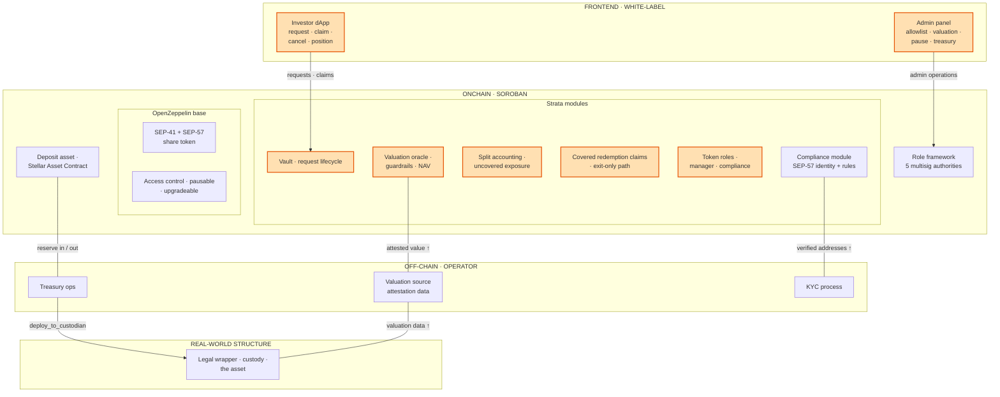
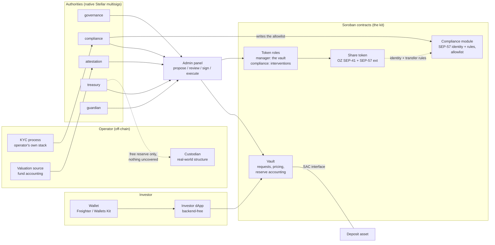
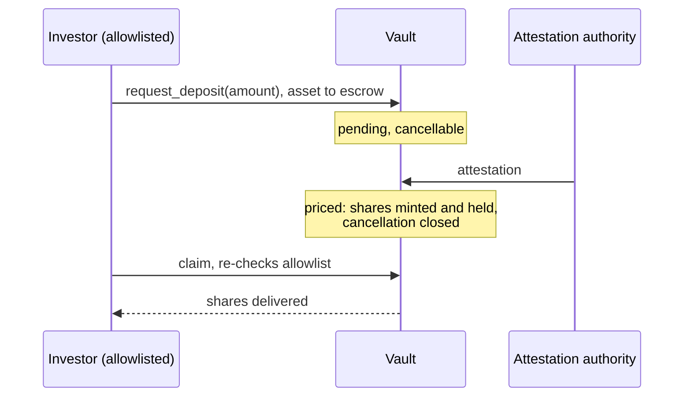
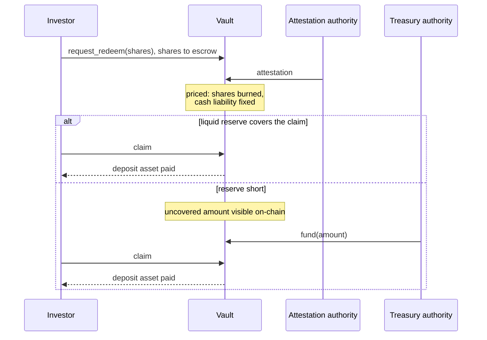
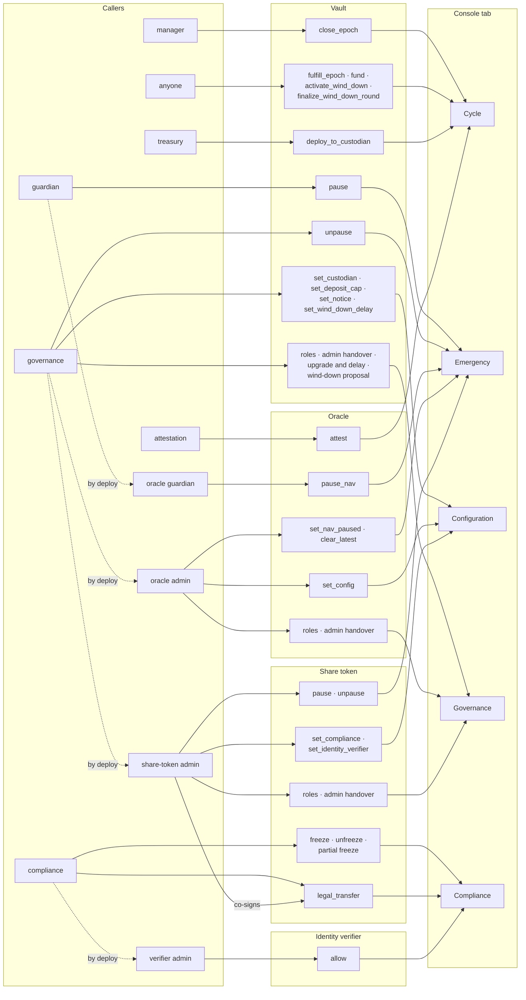

# Strata: Product and Architecture

## 1. What it is

Strata is an open-source vault kit on Stellar for teams whose capital works
off-chain: they raise funds on-chain, deploy it into a real-world structure, and
attest value back. Because no live market prices the asset, subscriptions and
redemptions are requests, priced against on-chain guarded attestations. Built on
OpenZeppelin's Stellar contracts and distributed as a kit: each operator
deploys, configures and brands an independent white-label instance, setting
roughly ten parameters and five authorities.

Shares in this vault are a claim on an off-chain asset whose value is attested
on chain. No price exists at the moment you act, so entry and exit are requests:
what you put in goes into escrow, the next accepted attestation prices it, and
you claim the result.

## 2. Problem

Every team tokenizing an off-chain asset builds the same vault: attested
valuation, reserve accounting, request-based subscriptions and redemptions,
separation of duties, and the mechanics to operate it. None of it is their
business, and all of it is trust-critical.

Because each implementation is private and one-off, the work never compounds: no
shared best practices, audits that start from zero every time, quality bounded
by one team's review. One open-source project solving exactly this inverts that:
one codebase hardened by every adopter, one audit surface, and each team's
effort going into its asset and its business.

## 3. Why these vaults are asynchronous

The vault does not hold the asset. The capital works off-chain, in things like
insurance treaties, bonds, or a vineyard's production, which take administrative
work to enter and exit and are not always liquid. Redemptions therefore cannot
be instant: they start with a request and settle later, when the position can
actually be unwound.

Pricing is asynchronous for the same reason. Since the asset is off-chain, the
contract cannot compute its value; someone accountable reports it, and the share
price derives from that attested NAV, published periodically rather than at the
moment of each transaction. Subscriptions and redemptions settle against a
published NAV, not against an instantaneous market price.

Finally, this is a regulated environment: shares cannot be bought freely.
Investors are vetted off-chain, and only allowlisted addresses can subscribe.

This is the shape ERC-7540 standardized on EVM: request-based deposits and
redemptions on top of the tokenized vault. Strata brings that shape to Stellar.

## 4. Solution

Strata is a vault kit: out-of-the-shelf Soroban contract modules plus
white-label frontends, built on top of existing Stellar tooling and
OpenZeppelin's contracts rather than replacing them. The contracts cover the
RWA-specific layer: a request-based vault on OpenZeppelin's token and contract
crates (SEP-41 share token with SEP-57 RWA extensions, access control, pausable,
upgradeable), a valuation oracle with on-chain guardrails, split reserve
accounting with explicit uncovered exposure, covered redemption claims, and
allowlist compliance.

The frontends cover operations: a white-label investor dApp for the LP and an
admin panel for the operator, both backend-free.

Everything ships as an Apache-2.0 template with reproducible, verified deploys,
so a team sets roughly ten parameters and five authorities, brands the frontend,
and runs its own instance. A standard SEP-40 price-feed adapter, so integrators
can consume the share price, is a planned addition and is not yet delivered.

What stays with the operator: legal entity, custody, KYC, the data behind the
attestation, and what the numbers mean. Deliberately not a custody, compliance,
or legal solution, and not a vault for on-chain RWA tokens.

## 5. Actors

| Actor | On-chain authority | Does |
|---|---|---|
| Investor (LP) | None (allowlisted address) | Requests deposits and redemptions, claims shares or cash, cancels pending requests, views position |
| Valuation reporter | attestation | Attests the share price under on-chain guardrails |
| Treasury ops | treasury | Moves free reserve between the vault and the custodian |
| Epoch sealer | manager (vault role, not an authority) | Seals the open epoch (`close_epoch`), nothing else; a vault role with its own key at deploy, meant to become permissionless (§8.4) |
| Compliance | compliance | Maintains the allowlist; token interventions (freeze; legal-order transfer and recovery, each co-signed by governance) |
| Guardian | guardian | Pauses the vault, which stops deposit requests, epoch pricing and upgrade application and freezes the upgrade timelock; can never block redemption requests, payable claims, or custodian deployments |
| Governance | governance | Parameters, roles, custodian rotation, upgrades, wind-down proposal and proposal cancellation; once each contract's one-time setup closes, the changes that can move value or shorten an exit wait for the timelock |
| Custodian | Not an authority | Off-chain party holding the real-world structure; a genesis-configured slot rotatable only by governance |

The authorities are native Stellar multisig accounts assigned at deploy, and
each contract grants its own roles to them. The vault makes governance its admin
and grants the manager, treasury and guardian roles. At construction it refuses a
treasury equal to guardian or governance, and a compliance equal to governance or
treasury; governance and guardian may be the same account, and the manager is
unconstrained. The oracle, the share token and the identity verifier each take
their admin as a constructor parameter, and the oracle its attester and guardian
too. The attestation authority holds the attester role. The deploy scripts give
the oracle's and the share token's admin to governance, the oracle's guardian to
the guardian account and the verifier's admin to the compliance account, but no
code ties those roles to the vault's; this document marks those equalities "by
deploy".

For the exhaustive access control matrix, dual `manager` role distinction, and entrypoint-level test mapping, see [`docs/AUTHORIZATION_MATRIX.md`](./AUTHORIZATION_MATRIX.md).

## 6. How it works

1. Compliance allowlists a verified investor.
2. The investor requests a subscription: USDC moves into escrow, cancellable
   until it is priced.
3. The reporter attests the share price. The epoch is priced, shares are minted
   at that price, and the investor claims them.
4. Treasury deploys free reserve into the real-world structure; attested value
   moves between pockets, the total does not change.
5. The investor requests a redemption: shares move into escrow, the next
   attestation prices them, and a fixed cash liability is created. Priced claims
   are never re-priced.
6. The investor claims the cash once the liquid reserve covers it, in any
   order; an earlier unpaid claim never blocks a later covered one. If the
   reserve falls short, the uncovered amount is visible on-chain and treasury
   tops up.

## 7. Who uses it

- An SCF-funded RWA team (reinsurance, trade finance, commodities) that wants to
  spend its grant on its business, not on vault plumbing.
- A fund or asset manager tokenizing an off-chain strategy for verified
  investors.
- An integrator or protocol consuming the vault share price the vault exposes
  on-chain (a standard SEP-40 feed adapter is a planned addition).

## 8. Architecture

### 8.1 Design principles

1. **Configured, not built.** Each operator deploys an independent instance: no
   factory, no shared state. A deployment is defined by its configuration and
   five authorities (native Stellar multisig accounts). Everything an operator
   brands or configures lives outside the trust boundary; everything inside it
   is the same code for every adopter.

2. **Built on OpenZeppelin, differentiated above it.** The share token is OZ's
   SEP-41 token with the SEP-57 RWA extensions (freeze, forced transfer,
   recovery); access control, pausable and upgradeable come from OZ crates.
   Dependencies are pinned to exact versions and audit inheritance is evaluated
   component by component; what Strata adds stays within its own audit scope.
   What OZ does not cover is the layer Strata adds: the attested valuation
   oracle, request-based flows priced against attestations, split reserve
   accounting, and the operational surface.

3. **Request-based entry and exit.** The exact price of a share does not exist
   when an investor acts; it is attested afterwards. Entry and exit are
   requests: funds or shares go into escrow, the epoch holding them is priced
   against an attestation, and the investor claims the result. This is the
   ERC-7540 pattern with two differences: cancellation is a single step, and the
   price comes from the attestation valid at pricing, not from a manager.
   Cancellation is an escape hatch rather than a choice: it closes as soon as
   the epoch could be priced, so nobody declines a price after reading it.

4. **Attested NAV.** The reporter attests the share price itself, computed
   off-chain from the deployed value and the vault's public figures under a
   documented methodology. The contract validates, stores and exposes it. Every
   on-chain operation preserves that price by construction: pricing a deposit
   releases escrow into the reserve and mints shares in proportion, pricing a
   redemption burns shares and fixes the matching liability, and a custodian
   transfer moves value between pockets without changing the total.

5. **Payable claims always pay.** Neither the guardian pause, a delisting, nor a
   stale valuation can block the payment of an already-priced, funded cash
   claim. A pause can delay unpriced requests. Priced claims are never re-priced
   and never identity-gated. A delisted, non-frozen investor exits through the
   exit-only cash path. A frozen investor's claims are held, not paid, until
   the freeze is lifted ([`COMPLIANCE_MATRIX.md`](./COMPLIANCE_MATRIX.md) §1).
   A legal-order transfer moves only shares in the investor's wallet, never
   value the vault holds. Outside this guarantee, disclosed as trust
   assumptions: deposit-asset issuer controls and reserve liquidity.

6. **Split accounting, with priced and payable as separate states.** The vault
   exposes committed (priced redemption liabilities), cancellable escrow
   (pending subscriptions the investor can still cancel) and free reserve.
   Escrowed subscriptions never leave the vault. Committed can exceed the liquid
   reserve; that gap is explicitly uncovered on-chain, outbound transfers are
   blocked while it exists, and every priced claim the reserve covers stays
   payable as treasury tops up. Being uncovered is not insolvency: solvency
   compares total attested assets against liabilities and is handled by attested
   losses and governance.

### 8.2 Component overview

Orange marks what only Strata provides; white is the existing ecosystem the kit
consumes or integrates.



Authority and contract wiring:



Which authority calls which entrypoint, per contract and console tab, is drawn
under the [Admin panel](#admin-panel) table in §8.8.

Both interfaces are backend-free: they read contract state and build
transactions that the authority multisigs sign. The chain never sees KYC data or
valuation methodology, only their outputs: an allowlisted address, an attested
number.

### 8.3 Components and authorities

| Component             | Role                                                                                                                                                                                                      | Controls                                                                                                                                                                      |
| --------------------- | --------------------------------------------------------------------------------------------------------------------------------------------------------------------------------------------------------- | ----------------------------------------------------------------------------------------------------------------------------------------------------------------------------- |
| **Vault**             | Request lifecycle, epoch sealing by its manager role, pricing, split reserve accounting, custodian transfers, upgrade control                                                                             | One authority per privileged entrypoint; upgrades behind a governance timelock no shorter than the notice, bounded between 7 and 90 days. The share token and the oracle upgrade under the same timelock. Administrative handover follows a strict two-step transfer pattern; renouncing admin is permanently refused (`AdminRequired`)                                                                                                                                                                                    |
| **Share token**       | OZ SEP-41 + SEP-57 RWA extensions: freeze, forced transfer, recovery, identity and compliance checks on every transfer, independent transfer pause (set only by the admin; governance by deploy)          | Manager role held only by the vault, for mint, burn and escrow; compliance role held by the compliance authority, for freezes, plus legal transfers and recovery co-signed by the token admin; swapping the compliance or identity-verifier contract needs the admin and, after a one-time setup, waits for the vault's timelock                                                                                                                                                                                                                          |
| **Token roles**       | Access-control roles on the share token, checked directly via native access control: `manager` mints, burns and escrows; `compliance` freezes, and makes legal transfers and recoveries co-signed by the token admin                              | Granted and revoked by the token admin (governance by deploy). After a one-time setup, a grant, revoking `manager` and an admin handover wait for the vault's timelock; revoking `compliance` stays instant                                                                                                                                                                                                                                                                                                                                                                                              |
| **Compliance module** | Implements the SEP-57 identity and rules interfaces the share token consults, with the allowlist as its only rule                                                                                         | The compliance authority writes the allowlist on the identity verifier. Governance runs the compliance contract as its admin: adding or removing a module and binding or unbinding a token are instant only during its one-time setup, and after it wait for the vault's timelock, cannot land while the vault is paused and never land during a wind-down. Replaceable by OZ's identity verifier and compliance contracts (with RWA Wizard modules); after setup, the token's swap to them waits for the vault's timelock |
| **Authorities**       | governance (parameters, roles, timelocked upgrades), compliance (allowlist, token interventions), attestation (valuation only), treasury (reserve movements only), guardian (pause; never payable claims) | Each contract grants its own roles; the oracle's, share token's and verifier's admins and the oracle's attester and guardian are constructor parameters independent of the vault's roles, equal to governance, compliance and guardian by deploy only; treasury and guardian distinct, treasury and governance distinct, compliance distinct from governance and treasury; governance and guardian may coincide; the vault's manager role is unconstrained |
| **Custodian**         | Off-chain party holding the real-world structure; a genesis-configured slot rotatable only by governance                                                                                                  | Not an on-chain authority                                                                                                                                                     |

Each authority's threshold is sized to the quorum that authority requires.
Signing of privileged operations through a coordinator is verified end to end,
not assumed.

### 8.4 Request lifecycle

Every position change is a request with three states: **pending, priced,
claimed**. Requests join the open epoch. Sealing an epoch closes it to new
requests and opens the next; it then waits out a notice set by governance before
it can be priced, and every request in the epoch waits the same. Pricing it reads
the oracle and fixes one share price for every request it holds. Pricing is
permissionless and refuses a feed that is not valid, so a sealed epoch waits
rather than settling at a stale price, and no investor can choose their price.

Sealing is gated on the manager role today. It is meant to become permissionless
once a minimum epoch duration bounds it; until then, whoever seals chooses the
batch boundary, though not the price it receives.

#### Subscription

- Request: moves the deposit asset into escrow; at most one active request per holder. The vault first asks the share token whether the address is frozen and asks the token's identity verifier, and refuses a frozen address or one that could not receive the shares, before any cash moves; the token checks again when it mints at claim time.
- Pricing: the escrow leaves the cancellable bucket, the share quantity is set at the epoch's price, and the economic supply liability is recorded. To avoid unbounded loops that exceed Soroban transaction resource limits, physical share minting occurs lazily when each investor executes `claim_deposit`.
- Cancellation: atomic, and returns the escrowed asset in full. Open while the epoch is open. Once sealed, a readable price closes it, even while the notice still runs: an investor who can see the price cannot decline it. If the vault can no longer price the epoch — the report expires, the NAV is paused, or the vault is paused — it opens again, so escrow is never stuck behind a stalled feed. The epoch is then priced at the latest valid report at fulfil time. Cancellation also remains open during an active wind-down, allowing pending depositors to recover their escrowed assets when pricing is closed. A frozen depositor's cancellation is held until the freeze is lifted, in a wind-down too.
- Share claim: verifies the receiver and delivers the shares via `mint`. A receiver off the allowlist gets no shares: they join the holder's redemption in the open epoch and are paid in cash at that epoch's price; in a wind-down they join the holder's wind-down entitlement. A frozen receiver is held until the freeze is lifted. No nominal refund exists after pricing.

#### Redemption

- Request: moves shares into escrow; at most one active request per holder per epoch. A frozen holder's request is held until the freeze is lifted; a partial freeze caps it to the free shares.
- Cancellation: atomic, and returns the escrowed shares under the same rules as subscription cancellation; stays open during an active wind-down, where the escrow joins the holder's wind-down entitlement instead of coming back as shares. A frozen holder's cancellation is held until the freeze is lifted.
- Pricing: the fixed cash liability enters committed at the epoch's price. Escrowed shares remain in the vault contract and are burned lazily as each claimant executes `claim_redeem`, preserving constant-bounded resource execution per transaction. Priced claims are never re-priced.
- Coverage: a priced claim is payable when the liquid reserve covers that claim's own amount, in any order. An earlier unpaid claim never blocks a later one that is already covered. The gap between committed and liquid reserve is the uncovered amount treasury must top up.
- Cash claim: pays the fixed amount; it does not depend on identity. A delisted, non-frozen investor uses the exit-only cash path and cannot cancel back to shares. A frozen investor's claim is held until the freeze is lifted.





### 8.5 Valuation and accounting

The NAV is a permissioned attestation of the share price. The reporter computes
it off-chain under a published methodology. A report carries the price and the
time until which the reporter vouches for it; it carries no proof reference yet.
The contract checks bounds, cooldown and the deviation cap, then stores the price
and exposes it with the liquidity figures it owns:

```text
liquid_reserve = reserve - cancellable_deposit_escrow
free_reserve   = max(liquid_reserve - committed - wind_down_owed, 0)
uncovered      = max(committed - liquid_reserve, 0)
```

`wind_down_owed` is what the wind-down rounds have credited to holders and they
have not claimed yet. It is zero outside a wind-down.

**Attestation guardrails:** the reporter is a multisig, never a single key.
Attestations are ordered by their acceptance time on the ledger. The price must
stay within configured bounds, a minimum cooldown bounds frequency, and the
deviation cap is directional: the upward bound is mandatory and non-zero, the
downward bound is required too, and setting it to 100% lets a loss of any size
land in one attestation. A report's own expiry can shorten its life but never
extend it past the freshness window, and no report is accepted while the NAV is
paused: unpausing it is a deliberate act before reporting resumes. An epoch is
never priced against a valuation accepted before it closed, and the oracle's
cooldown therefore bounds how soon a closed epoch can be priced.

**Freshness and pause:** each attestation opens a validity window; when it
lapses the feed is stale and new requests stop being priced. The guardian can
pause the vault: deposit requests, epoch pricing and upgrade application stop
and the upgrade timelock freezes; redemption requests, custodian deployments,
payable claims, and pending cancellations continue; attestations that pass the
guardrails are still accepted, so recovery never deadlocks. Only governance
lifts the pause. Unpause is an administrative override that does not condition
on oracle freshness, preventing deadlock if the feed is halted or stale. Paused
and stale are independent: freshness lapses on its own, the pause is an
administrative decision.

**The share token's pause is separate.** The token has its own transfer pause,
controlled by the token's admin (governance) and never by the guardian. While
active it refuses SEP-41 transfers between holders. The vault's own escrow
moves (escrowing a redemption, returning escrowed shares on `cancel_redeem`),
pricing, share and cash claims, mint, burn and forced transfer are unaffected.
It is a trading restriction, not an emergency stop for the vault, and only
governance lifts it.

**Integrator surface:** the oracle exposes the attested share price directly:
the latest report with its acceptance time and expiry (`latest`), the price
alone (`nav_per_share`) and the acceptance time alone (`attested_at`). The
SEP-40 feed named in section 4 is an adapter over that surface scheduled for
Tranche 3 and is not implemented yet; integrators read the oracle's own
interface today.

### 8.6 Compliance

- The share token follows the SEP-57 topology: it consults identity for every
  receiver and rules for every transfer. The kit ships one compliance module for
  both, with the allowlist as its only rule; an operator needing richer rules
  replaces it with OZ's contracts without touching the token.
- KYC happens wherever the operator runs it; the chain sees only its output. The
  compliance authority writes allowlist entries on the identity verifier.
- Token interventions are compliance operations through the share token's
  `compliance` role, available even while the vault is paused. Freezing and
  unfreezing are compliance's alone; moving shares under a legal order
  (`legal_transfer`) and recovering a lost wallet (`recover_balance`) also need
  governance's signature in the same call. Neither moves shares out of or into
  the vault's address, and that address cannot be frozen once the token knows
  its vault; an earlier freeze makes the vault's `finish_setup` refuse.
- The complete specification of investor states (Allowlisted, De-listed, Frozen)
  and the exit-only cash path across all vault lifecycle operations is detailed in
  [`docs/COMPLIANCE_MATRIX.md`](./COMPLIANCE_MATRIX.md).

### 8.7 Treasury and custodian

- The custodian is a genesis-configured slot; only governance can rotate it.
  Transfers to the custodian move free reserve only, only to that address, and
  only while nothing is uncovered.
- Transfers from the custodian are always open and credit only assets actually
  received.
- The exposed figures (share price, liquid reserve, committed, uncovered) make
  reserve coverage legible to investors and integrators.
- Closing a vault is a dedicated, announced state. Governance proposes a
  wind-down and may cancel the proposal during the delay, which is never shorter
  than seven days. Once its delay has run,
  anyone may activate it, so the operator cannot announce a closure and then stall
  it. Once activated, wind-down is strictly irreversible: the vault permanently
  ceases regular intake and distributes capital through pro-rata rounds. While it
  is active the vault takes no new requests, prices nothing and sends nothing to
  the custodian, while cancellation, priced claims and funding all stay open.
  Anyone may then finalize distribution rounds: each round takes the free
  reserve, so priced exit liabilities and refundable subscription escrow are paid
  first, and holders pull their pro-rata share against a supply snapshot taken at
  the first round. Every payment rounds in the vault's favour and the remainder
  joins the next round's pot.
- A wind-down distributes what is on chain. The vault cannot compel the custodian
  to return capital; recovering the rest is off-chain work, and nothing here is a
  guarantee that it will be recovered. Two further limits are on the record: a
  holder who never surrenders their shares is never paid, because no entrypoint
  may iterate over holders; a refund owed to a deposit priced at zero shares
  is not tracked as a cash liability, so a round can credit the assets it needed;
  and symmetrically, a redemption priced at zero assets pays nothing, and once
  the wind-down is active its claim burns the escrowed shares instead of
  returning them.
- A compliance module can block wind-down claims. A claim that surrenders shares
  burns them through the token, which calls the compliance contract's
  `destroyed` hook, so a module that starts failing during a wind-down blocks
  those claims; it cannot be removed then, because removing a module waits for
  the timelock and no timelocked change applies during a wind-down.
- Funding a vault that is winding down cannot be undone. What arrives first
  covers priced exits and refundable escrow; the surplus is taken by the next
  round and credited to holders, and no entrypoint returns it. Treasury sends
  only what it intends to distribute.
- A wind-down never declares itself finished, because no holder can be made to
  claim. It is finished when three exposed figures read zero together: what the
  rounds still owe holders (zero up to rounding dust), the share supply, and the
  free reserve. The owed figure counts holders who have not claimed yet and falls
  only when one is paid, so its reaching zero up to rounding dust means every credit
  has been collected rather than merely offered.

### 8.8 Reference interfaces

Both interfaces are part of the kit: they are how investors and operators use
the protocol without writing code. Both are backend-free and read only the
public contract surface; each deployment brands and hosts its own.

### Investor dApp

The investor's five actions and nothing else: deposit request, share claim,
redeem request, cash claim, cancellation of a pending request. Nothing is valued
at request creation; the only reference shown is the latest attested NAV,
labelled and timestamped. Three states per side, none skipped: pending, priced,
claimed. Waiting is stated, never counted down. A priced cash claim shows
whether the reserve covers it and the current uncovered amount; a delisted
investor sees the exit-only path.

### Admin panel

Operates an existing vault; deploys nothing. Each privileged entrypoint needs
one role of one contract, except the share token's `legal_transfer` and
`recover_balance`, which need its `compliance` role and its admin in the same
call. The oracle's NAV pause has
two entrypoints: `pause_nav` for its guardian and `set_nav_paused` for its
admin. The panel groups the entrypoints into five domain surfaces. A surface is
visible to the authorities that act in it, and each action only to its own
(permissionless actions to any connected address):

| Surface       | Caller                                                                                                      | Cadence             | Operations                                                                                                                                                                                                             |
| ------------- | ----------------------------------------------------------------------------------------------------------- | ------------------- | ---------------------------------------------------------------------------------------------------------------------------------------------------------------------------------------------------------------------- |
| Cycle         | manager, attestation, treasury; anyone prices, funds, activates and finalizes                               | Continuous          | Epoch sealing (manager); attestations; transfers to the custodian (treasury); pricing, funding, wind-down activation and round finalization (permissionless)                                                           |
| Compliance    | compliance; verifier admin (compliance by deploy); share-token admin (governance by deploy) as co-signer    | Continuous          | Allowlist (verifier admin); freeze/unfreeze of an address or of part of its shares (compliance); legal-order transfer (compliance and share-token admin); recovery is not offered, the kit's verifier names no target  |
| Emergency     | guardian, governance; oracle admin and share-token admin (both governance by deploy)                        | Rare and urgent     | Vault pause (guardian) and unpause (governance); oracle NAV pause (oracle guardian, or oracle admin through `set_nav_paused`), reset and `clear_latest` (oracle admin); share-token pause/unpause (share-token admin) |
| Configuration | governance; oracle admin and share-token admin (both governance by deploy)                                  | Rare and deliberate | Custodian slot, deposit cap, notice and wind-down delay (governance); oracle guardrails (oracle admin); compliance and identity-verifier contracts (share-token admin). After setup, the vault's custodian and a lower notice or wind-down delay wait for the timelock, as do the oracle and token changes listed in §8.9; raising the notice or the delay and the deposit cap stay instant |
| Governance    | governance; oracle admin and share-token admin for their own roles and handover (both governance by deploy) | Very rare           | Roles and admin handover on the vault, oracle and share token; upgrade and its delay, wind-down proposal and cancellation (governance). After setup, every grant, `manager` revoke, handover and upgrade waits for the timelock; revoking an operational role (treasury, guardian, attester, compliance) stays instant |



Dashed edges hold by deploy only (§5). Guards, preconditions and the tests that
pin each entrypoint are in
[`docs/AUTHORIZATION_MATRIX.md`](./AUTHORIZATION_MATRIX.md).

Every operation is shown in domain terms, with its conditions and resulting
state, before a signature is requested; read-only by default. Signing runs
through an existing self-hostable coordinator. Configuration is derived from the
public surface given the vault address.

### 8.9 Trust boundaries & failure modes

| Boundary               | Risk                                           | Mitigation                                                                                                                                                                                                                                                                                                                                                                                                                                                       |
| ---------------------- | ---------------------------------------------- | ---------------------------------------------------------------------------------------------------------------------------------------------------------------------------------------------------------------------------------------------------------------------------------------------------------------------------------------------------------------------------------------------------------------------------------------------------------------- |
| Attestation authority  | Wrong or compromised reports misprice requests | Multisig reporter; the deviation cap bounds a single report in both directions, and a downward cap of 100% leaves `min_answer` as the only floor; the cooldown bounds frequency; a sustained sequence of biased reports within the cap remains possible, is bounded in speed, and is the monitoring plan's primary alert, with the guardian pause as the reactive control. Residual risk: value transfer between entry and exit cohorts. A compromised attester is replaced in this order: pause the NAV, revoke the attester (instant), grant a replacement (through the timelock after setup, so the NAV stays paused that long), clear the stored report if it is wrong, then lift the pause ([`kit-spec.md`](./kit-spec.md) §3) |
| Governance keys        | Malicious upgrade                              | Timelock on every code change and on the delay itself: at least seven days, never shorter than the standing notice, at most 90 days. The delay is an announcement period. A pause freezes the timelock clock and pushes the ETA back by the time paused, so the whole delay runs unpaused, and applying while paused is refused. The delay does not guarantee an exit before a change lands: an exit also needs a sealed epoch, a valid price accepted after the seal, and cash in the reserve to pay the claim. Nothing is proposed or applied while the vault winds down. The vault's own custodian, role grants, `manager` revocations, admin handovers and lowering of the notice or the wind-down delay wait on that clock once its one-time setup closes, and it takes no deposit before then; revoking its treasury or guardian stays instant. Setup closes only once the token and the oracle run on the vault's clock with their own setup closed, the vault is the token's only minter, no shares exist yet (shares minted earlier would redeem against depositors' money), the vault passes the identity check, its address is not frozen on the token, the token is bound to its compliance contract, the asset has the token's decimals, the asset, the token, the oracle and the vault are four different addresses, the oracle answers the feed interface, and a custodian other than the vault is set; the kit's own compliance contract must also run on the vault's clock with its setup closed. The share token's upgrades, grants, `manager` revocations, admin handovers and compliance or verifier swaps wait on the same clock once its setup closes. So do the oracle's upgrades, grants, admin handovers and every guardrail change except a shorter freshness window; its NAV pause, `clear_latest` and revoking its attester or guardian stay instant. On the kit's compliance contract, adding or removing a module, binding or unbinding a token and handing over the admin wait on the same clock once its setup closes. |
| Mis-wired deployment   | A vault goes live without every binding wired  | `health()` reports each wiring step; `finish_setup` refuses until all hold, and the vault takes no deposit before that                                                                                                                                                                                                                                                                                                                                             |
| Treasury keys          | Reserve drained                                | Only free reserve is movable, only to the genesis-configured custodian, verified on-chain; outbound transfers are blocked while anything is uncovered, and escrowed subscriptions never leave the vault                                                                                                                                                                                                                                                          |
| Guardian keys          | Griefing via pause                             | Guardian can only pause the vault, which stops deposit requests, epoch pricing and upgrade application and freezes the upgrade timelock; it cannot halt redemptions, custodian deployments, or payable claims, nor move funds; governance unpauses and rotates the vault role. It holds no role on the share token: the token's transfer pause is admin-gated (governance by deploy), not a guardian lever. No contract keeps governance and guardian apart |
| Share-token pause      | Secondary transfers halted                     | Controlled by governance (the token admin), never the guardian; it refuses SEP-41 transfers between holders only, never the vault's escrow moves, pricing, claims, mint, burn or forced transfer; only governance lifts it (§8.5) |
| Compliance keys        | Wrongful delisting, freeze or transfer         | Delisted investors keep the exit-only cash path; freezes require the share token's compliance role and are auditable per operation; moving a holder's shares also needs governance's signature in the same call, lands only on an allowlisted account and never moves shares out of or into the vault's address, which cannot be frozen once the token knows its vault |
| Vault's own listing    | Compliance delists the vault's address         | Share returns do not depend on it: the vault checks the holder itself and moves the shares as the token's manager. A delisted holder's conversion, which mints into the vault's escrow, waits until the vault is allowlisted again; nothing is lost, and `health().allowlisted` turns false |
| Compliance module      | Faulty module blocks transfers                 | Fail-closed semantics. Governance, the compliance contract's admin, adds and removes modules: instantly during its one-time setup, and after it only through the vault's timelock, so a change cannot land while the vault is paused and never lands during a wind-down. Removing a faulty module waits the same way, and during a wind-down it cannot be removed at all (§8.7) |
| Deposit asset issuer   | Freeze or clawback of the vault's reserve      | Not mitigated by the kit; declared risk of the chosen asset, verified and reported at genesis (auth flags)                                                                                                                                                                                                                                                                                                                                                       |
| Custodian / real world | Underlying loss or delay                       | Reflected through attested NAV; the kit constrains what reaches the chain, it does not verify the world                                                                                                                                                                                                                                                                                                                                                          |
| Wind-down distribution | Unfinalized rounds stall distribution          | Finalizing a round is permissionless: once treasury returns capital, anyone can finalize the round to credit holders; the operator cannot stall payouts after funding                                                                                                                                                                                                                                                                                           |

Disclosed trust assumptions: the accuracy of the operator's KYC process, the
quality of the data behind each attestation, and the operator's key ceremony.

### 8.10 Deployment

Deployment is scripted and ends with no human key holding governance. It is
complete only when the final state is verified on-chain: every authority is the
intended multisig, no bootstrap key retains any role, the configuration matches
the request, and the deposit asset's auth flags are checked and reported.

## 9. Relationship to existing Stellar tooling

Where a cell says "Not provided", it means: not provided by SEP-41, SEP-56,
SEP-57, OpenZeppelin Stellar Contracts, or the Soroban vault implementations
evaluated (Templar, Untangled OctoVault, DeFindex).

| Component                                                                | Already exists                                                             | Strata                                                                                                                                                                                 |
| ------------------------------------------------------------------------ | -------------------------------------------------------------------------- | -------------------------------------------------------------------------------------------------------------------------------------------------------------------------------------- |
| SEP-41 token + SEP-57 RWA extensions (freeze, forced transfer, recovery) | OpenZeppelin stellar-tokens; the RWA Wizard scaffolds the regulated token  | Consumed and extended; the kit's compliance module implements the SEP-57 interfaces the token expects                                                                                  |
| Synchronous tokenized vault                                              | SEP-56 / OZ Token Vault                                                    | Not a base for Strata: SEP-56 assumes the price exists at call time, so its interface cannot express a request lifecycle. Only OZ conversion and rounding math reused, as library code |
| Access control, pausable, upgradeable, timelock                          | OZ crates                                                                  | Consumed; pinned by exact version, audit coverage and gaps documented per component                                                                                                    |
| Multisig and signing coordination                                        | Native Stellar + existing coordinators, OZ Role Manager                    | Integrated                                                                                                                                                                             |
| Request lifecycle priced against attestations                            | Not provided (ERC-7540 on EVM, where OpenZeppelin ships an implementation) | Core of the kit                                                                                                                                                                        |
| Guarded valuation oracle with freshness and pause                        | Not provided                                                               | Core of the kit                                                                                                                                                                        |
| Split reserve accounting with explicit uncovered exposure                | Not provided                                                               | Core of the kit                                                                                                                                                                        |
| Covered redemption claims, exit-only path                                | Not provided                                                               | Core of the kit                                                                                                                                                                        |
| Reusable RWA configuration, verified genesis, white-label frontends      | Not provided                                                               | Core of the kit                                                                                                                                                                        |

## 10. Delivery phases

| Phase                                                   | Deliverables                                                                                                                                                                                                                   | Evidence of completion                                                                                                                                                                                                  |
| ------------------------------------------------------- | ------------------------------------------------------------------------------------------------------------------------------------------------------------------------------------------------------------------------------ | ----------------------------------------------------------------------------------------------------------------------------------------------------------------------------------------------------------------------- |
| **1: Attested valuation and request pricing**           | Valuation oracle with guardrails, freshness and pause; request lifecycle with escrow, cancellation and pricing-time mint and burn; public kit spec                                                                             | Accounting property tests green in CI (price preserved by deposits, redemptions and custodian transfers; cancellation; rounding); multisig signing of privileged operations verified end to end through the coordinator |
| **2: Split accounting and redemption**                  | Uncovered exposure; covered redemption claims; exit-only cash path; SEP-57 integration (compliance module, delisted-investor path); threat model and monitoring plan                                                           | Settlement e2e test at 1, 10, 100 and 1,000 pending requests; SEP-57 path demonstrated end to end on testnet                                                                                                            |
| **3: Reference interfaces, audit remediation, mainnet** | Investor dApp and Admin panel (five surfaces, one per authority), backend-free; reproducible deployment; audit remediation (all critical and high findings fixed and verified, public changelog); mainnet reference deployment | Audit inheritance matrix published (component, version, audit report, Strata delta, resulting scope); external developer deploys a configured instance from docs alone; reference instance live on mainnet              |

The funded core is the valuation, pricing and accounting layer. The Investor
dApp and the Admin panel are how that core is used by investors and operators;
without the Admin panel the five authorities are not operable by a
non-developer, and the kit stops being a kit.

## 11. Potential future features

The items below are candidate extensions, deliberately excluded from v1 to keep
the scope narrow. They will be evaluated and prioritized after v1, based on
adopter feedback and adoption metrics. Ordered by expected business impact.

1. **Fee module.** Management and performance fees with a high-water mark,
   crystallized by share dilution; rates as per-deployment configuration.
2. **Operator notifications and alerting.** Implementation of the monitoring
   plan as push alerts (stale valuation, reserve coverage, privileged actions)
   via DMe, BootNode's open-source notification layer.
3. **No-code vault launcher.** A wizard that configures and deploys a vault
   instance without touching code.
4. **Factory contract.** One-transaction deployment of a configured vault
   instance.
5. **Investor lost-key recovery.** A documented clawback-and-reissue procedure
   for verified investors.
6. **Large-ticket handling.** Auto-slicing of large subscriptions into
   execution-sized intents with progressive settlement.
7. **Per-investor caps.** Subscription ceilings per investor and per call, as
   compliance configuration.
8. **Valuation history.** On-chain history buffer plus an off-chain collector,
   API and charts (Stellar retains events only days).
9. **SEP-12 KYC onboarding adapter.** Standard interface between the allowlist
   and existing KYC providers.
10. **CCTP integration.** Native USDC in and out of Stellar for cross-chain
    subscriptions and treasury mobility.
11. **Reconciliation service.** Event-driven off-chain mirror of vault state
    with invariant checks and alerts on discrepancies.
12. **Oracle override path.** A second-signature path to record genuine extreme
    market moves past the deviation cap.
13. **SEP-57 (T-REX) wider support.** Extend SEP-57 coverage as the standard
    matures, for richer on-chain compliance.
