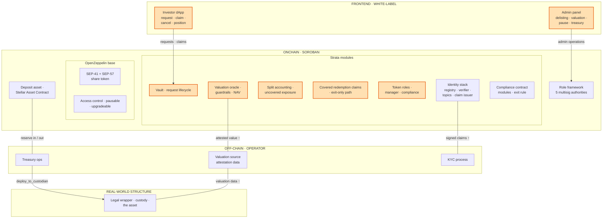
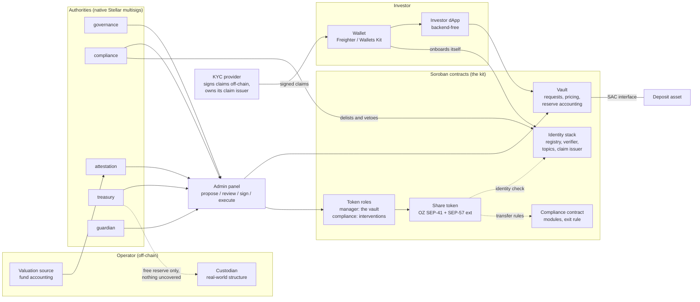
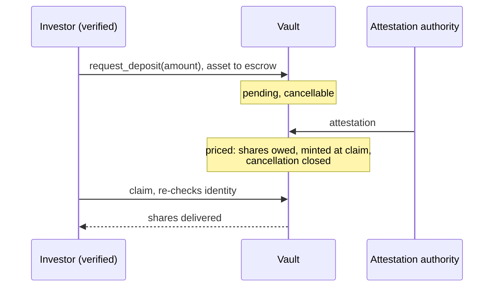
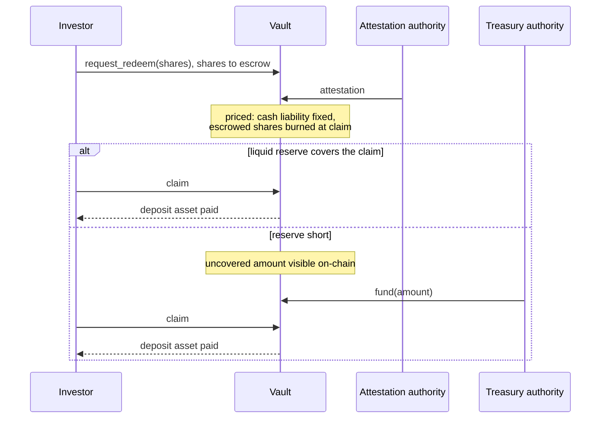
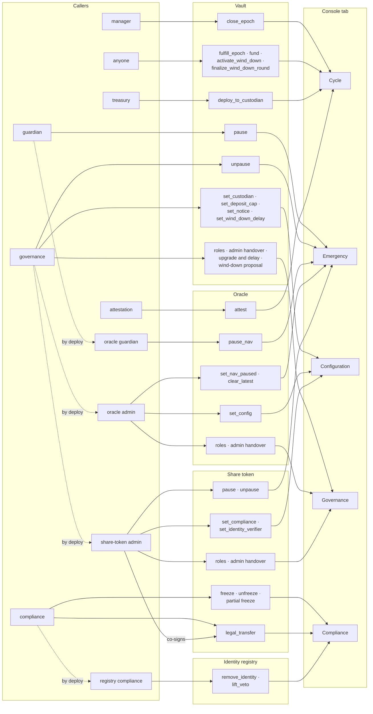

# Strata: Product and Architecture

## 1. What it is

Strata is an open-source vault kit on Stellar for teams whose capital works
off-chain: they raise funds on-chain, deploy it into a real-world structure, and
attest value back. Because no live market prices the asset, subscriptions and
redemptions are requests, priced against on-chain guarded attestations. Built on
OpenZeppelin's Stellar contracts and distributed as a kit: each operator
deploys, configures and brands an independent white-label instance, setting
roughly ten parameters and five authorities.

Shares in this vault are a claim on an off-chain asset whose value is attested
on chain. No price exists at the moment you act, so entry and exit are requests:
what you put in goes into escrow, the next accepted attestation prices it, and
you claim the result.

## 2. Problem

Every team tokenizing an off-chain asset builds the same vault: attested
valuation, reserve accounting, request-based subscriptions and redemptions,
separation of duties, and the mechanics to operate it. None of it is their
business, and all of it is trust-critical.

Because each implementation is private and one-off, the work never compounds: no
shared best practices, audits that start from zero every time, quality bounded
by one team's review. One open-source project solving exactly this inverts that:
one codebase hardened by every adopter, one audit surface, and each team's
effort going into its asset and its business.

## 3. Why these vaults are asynchronous

The vault does not hold the asset. The capital works off-chain, in things like
insurance treaties, bonds, or a vineyard's production, which take administrative
work to enter and exit and are not always liquid. Redemptions therefore cannot
be instant: they start with a request and settle later, when the position can
actually be unwound.

Pricing is asynchronous for the same reason. Since the asset is off-chain, the
contract cannot compute its value; someone accountable reports it, and the share
price derives from that attested NAV, published periodically rather than at the
moment of each transaction. Subscriptions and redemptions settle against a
published NAV, not against an instantaneous market price.

Finally, this is a regulated environment: shares cannot be bought freely.
Investors are vetted off-chain, and only wallets that hold a valid KYC claim
can subscribe.

This is the shape ERC-7540 standardized on EVM: request-based deposits and
redemptions on top of the tokenized vault. Strata brings that shape to Stellar.

## 4. Solution

Strata is a vault kit: out-of-the-shelf Soroban contract modules plus
white-label frontends, built on top of existing Stellar tooling and
OpenZeppelin's contracts rather than replacing them. The contracts cover the
RWA-specific layer: a request-based vault on OpenZeppelin's token and contract
crates (SEP-41 share token with SEP-57 RWA extensions, access control, pausable,
upgradeable), a valuation oracle with on-chain guardrails, split reserve
accounting with explicit uncovered exposure, covered redemption claims, and
identity checks built on OpenZeppelin's RWA identity contracts: investors bring
KYC claims signed by a provider the fund trusts.

The frontends cover operations: a white-label investor dApp for the LP and an
admin panel for the operator, both backend-free.

Everything ships as an Apache-2.0 template with reproducible, verified deploys,
so a team sets roughly ten parameters and five authorities, brands the frontend,
and runs its own instance. A standard SEP-40 price-feed adapter, so integrators
can consume the share price, ships with the kit; it is optional, one per vault,
and a deployment that does not need it can skip it.

What stays with the operator: legal entity, custody, KYC, the data behind the
attestation, and what the numbers mean. Deliberately not a custody, compliance,
or legal solution, and not a vault for on-chain RWA tokens.

## 5. Actors

| Actor | On-chain authority | Does |
|---|---|---|
| Investor (LP) | None (a verified wallet) | Onboards itself with the KYC claims a provider signed; requests deposits and redemptions, claims shares or cash, cancels pending requests, views position |
| KYC provider | Not an authority; owns its claim issuer contract | Checks investors off-chain and signs claims for those who qualify; allows its signing keys, revokes one claim or invalidates all of an identity's claims on a topic. Runs no service for the kit |
| Valuation reporter | attestation | Attests the share price under on-chain guardrails |
| Treasury ops | treasury | Moves free reserve between the vault and the custodian |
| Epoch sealer | manager (vault role, not an authority) | Seals the open epoch (`close_epoch`), nothing else; a vault role with its own key at deploy. Once governance sets a minimum epoch duration, anyone may also seal an epoch open that long (§8.4) |
| Compliance | compliance | Delists and vetoes wallets on the identity registry, lifts a veto, lists a wallet whose claims pass; token interventions (freeze; legal-order transfer, co-signed by governance) |
| Guardian | guardian | Pauses the vault, which stops deposit requests, epoch pricing and upgrade application and freezes the upgrade timelock; can never block redemption requests, payable claims, or custodian deployments |
| Governance | governance | Parameters, roles, custodian rotation, upgrades, wind-down proposal and proposal cancellation; once each contract's one-time setup closes, the changes that can move value or shorten an exit wait for the timelock |
| Custodian | Not an authority | Off-chain party holding the real-world structure; a genesis-configured slot rotatable only by governance |

The authorities are meant to be native Stellar multisig accounts, assigned at
deploy, and each contract grants its own roles to them. The deploy script does
not create multisig accounts yet: it gives each authority one key (§8.10). The
vault makes governance its admin and grants the manager, treasury and guardian
roles. At construction it refuses a treasury equal to guardian or governance,
and a compliance equal to governance or treasury; governance and guardian may be
the same account, and the manager is unconstrained. The oracle, the share
token, the compliance contract and the three governed identity contracts (claim
topics, identity registry, identity verifier) each take their admin as a
constructor parameter, the oracle its attester and guardian too, and the
registry its compliance authority. The attestation authority holds the attester
role. The deploy scripts give every one of those admins to governance, the
oracle's guardian to the guardian account and the registry's compliance
authority to the compliance account. The vault's `finish_setup` checks that
governance is the admin of the compliance contract and the three identity
contracts (§8.6); no code ties the other roles to the vault's, and this document
marks those equalities "by deploy".

For the exhaustive access control matrix, dual `manager` role distinction, and entrypoint-level test mapping, see [`docs/AUTHORIZATION_MATRIX.md`](./AUTHORIZATION_MATRIX.md).

## 6. How it works

1. The investor passes KYC with a provider off-chain, then onboards in one
   transaction: the identity registry deploys the investor's identity contract,
   stores the claims the provider signed, and links the wallet once the claims
   pass.
2. The investor requests a subscription: USDC moves into escrow, cancellable
   until it is priced.
3. The reporter attests the share price. The epoch is priced, shares are minted
   at that price, and the investor claims them.
4. Treasury deploys free reserve into the real-world structure; attested value
   moves between pockets, the total does not change.
5. The investor requests a redemption: shares move into escrow, the next
   attestation prices them, and a fixed cash liability is created. Priced claims
   are never re-priced.
6. The investor claims the cash once the liquid reserve covers it, in any
   order; an earlier unpaid claim never blocks a later covered one. If the
   reserve falls short, the uncovered amount is visible on-chain and treasury
   tops up.

## 7. Who uses it

- An SCF-funded RWA team (reinsurance, trade finance, commodities) that wants to
  spend its grant on its business, not on vault plumbing.
- A fund or asset manager tokenizing an off-chain strategy for verified
  investors.
- An integrator or protocol consuming the vault share price through the kit's
  SEP-40 feed, an optional adapter deployed alongside the vault.

## 8. Architecture

### 8.1 Design principles

1. **Configured, not built.** Each operator deploys an independent instance: no
   factory, no shared state. A deployment is defined by its configuration and
   five authorities (native Stellar multisig accounts). Everything an operator
   brands or configures lives outside the trust boundary; everything inside it
   is the same code for every adopter.

2. **Built on OpenZeppelin, differentiated above it.** The share token is OZ's
   SEP-41 token with the SEP-57 RWA extensions (freeze, forced transfer,
   recovery); access control, pausable and upgradeable come from OZ crates. It
   follows SEP-41 for balances, allowances and transfers. Its `burn` is the
   RWA extension's manager-only `burn(user, amount, operator)`, and it has no
   `burn_from`: a holder cannot burn their own shares, and a generic SEP-41
   client's burn call fails. Dependencies are pinned to exact versions
   and audit inheritance is evaluated component by component; what Strata adds
   stays within its own audit scope. What OZ does not cover is the layer Strata
   adds: the attested valuation oracle, request-based flows priced against
   attestations, split reserve accounting, and the operational surface.

3. **Request-based entry and exit.** The exact price of a share does not exist
   when an investor acts; it is attested afterwards. Entry and exit are
   requests: funds or shares go into escrow, the epoch holding them is priced
   against an attestation, and the investor claims the result. This is the
   ERC-7540 pattern with two differences: cancellation is a single step, and the
   price comes from the attestation valid at pricing, not from a manager.
   Cancellation is an escape hatch rather than a choice: it closes as soon as
   the epoch could be priced, so nobody declines a price after reading it.

4. **Attested NAV.** The reporter attests the share price itself, computed
   off-chain from the deployed value and the vault's public figures under a
   documented methodology. The contract validates, stores and exposes it. Every
   on-chain operation preserves that price by construction: pricing a deposit
   releases escrow into the reserve and owes shares in proportion, pricing a
   redemption fixes the cash owed for its escrowed shares, and a custodian
   transfer moves value between pockets without changing the total. Shares are
   minted and burned only when each claim runs; the economic supply counts owed
   shares from pricing and leaves escrowed shares out from the request.

5. **Payable claims always pay.** Neither the guardian pause, a delisting, nor a
   stale valuation can block the payment of an already-priced, funded cash
   claim. A pause can delay unpriced requests. Priced claims are never
   re-priced, and a cash payout never needs the identity check. A delisted,
   non-frozen investor exits through the exit-only cash path. One case differs:
   a redemption priced at zero assets pays no cash. It returns the shares to
   a holder who may take them back, and burns them otherwise, always during a
   wind-down; a verifier fault instead of an answer makes the claim wait, but
   a compliance module that fails counts as one that refuses
   ([`COMPLIANCE_MATRIX.md`](./COMPLIANCE_MATRIX.md) §2). No compliance module
   can stop a move into the vault's escrow or a burn: the kit's compliance
   contract ignores a module's refusal there (§8.6). A frozen investor's
   claims are held, not paid, until the freeze is lifted
   ([`COMPLIANCE_MATRIX.md`](./COMPLIANCE_MATRIX.md) §1). A legal-order transfer
   moves only shares in the investor's wallet, never value the vault holds.
   Outside this guarantee, disclosed as trust assumptions: deposit-asset issuer
   controls and reserve liquidity.

6. **Split accounting, with priced and payable as separate states.** The vault
   exposes committed (priced redemption liabilities), cancellable escrow
   (pending subscriptions the investor can still cancel) and free reserve.
   Escrowed subscriptions never leave the vault. Committed can exceed the liquid
   reserve; that gap is explicitly uncovered on-chain, outbound transfers are
   blocked while it exists, and every priced claim the reserve covers stays
   payable as treasury tops up. Being uncovered is not insolvency: solvency
   compares total attested assets against liabilities and is handled by attested
   losses and governance.

### 8.2 Component overview

Orange marks what only Strata provides; white is the existing ecosystem the kit
consumes or integrates.



Authority and contract wiring:



Which authority calls which entrypoint, per contract and console tab, is drawn
under the [Admin panel](#admin-panel) table in §8.8.

Both interfaces are backend-free: they read contract state and build
transactions that the authority multisigs sign. The chain never sees KYC data or
valuation methodology, only their outputs: a provider's signed claim for each
topic a fund requires, which needs no personal data (§8.6), and an attested
number with a hash of its evidence and, optionally, where to read it.

The SEP-40 feed sits outside this wiring. It is an optional contract, deployed
after the vault's own setup with just the vault's address, and nothing above
is changed or re-signed to add it: the vault does not know the feed exists, and
removing the feed takes nothing away from the vault.

### 8.3 Components and authorities

| Component             | Role                                                                                                                                                                                                      | Controls                                                                                                                                                                      |
| --------------------- | --------------------------------------------------------------------------------------------------------------------------------------------------------------------------------------------------------- | ----------------------------------------------------------------------------------------------------------------------------------------------------------------------------- |
| **Vault**             | Request lifecycle, epoch sealing by its manager role, or by anyone once the minimum epoch duration has run, pricing, split reserve accounting, custodian transfers, upgrade control                                                                             | One authority per privileged entrypoint; upgrades behind a governance timelock no shorter than the notice, bounded between 7 and 90 days. The share token and the oracle upgrade under the same timelock. Administrative handover follows a strict two-step transfer pattern; renouncing admin is permanently refused (`AdminRequired`)                                                                                                                                                                                    |
| **Share token**       | OZ SEP-41 + SEP-57 RWA extensions: freeze, forced transfer, recovery, identity and compliance checks on every transfer, independent transfer pause (set only by the admin; governance by deploy)          | Manager role held only by the vault, for mint, burn (per the RWA extension, §8.1) and escrow; compliance role held by the compliance authority, for freezes, plus legal transfers and recovery co-signed by the token admin; swapping the compliance or identity-verifier contract needs the admin and, after a one-time setup, waits for the vault's timelock, as do the token's upgrades, role grants and admin hand-overs. New rules must list the token and, if they answer `VaultBinding`, run on the vault's clock; as at setup, an external module that does not answer is accepted on trust. A new verifier must accept the vault. Both are checked when the swap is proposed and when it applies |
| **Token roles**       | Access-control roles on the share token, checked directly via native access control: `manager` mints, burns and escrows; `compliance` freezes, and makes legal transfers and recoveries co-signed by the token admin                              | Granted and revoked by the token admin (governance by deploy). After a one-time setup, a grant, revoking `manager` and an admin handover wait for the vault's timelock; revoking `compliance` stays instant                                                                                                                                                                                                                                                                                                                                                                                              |
| **Identity stack**    | The identity verifier the share token consults on every mint and transfer, built on OpenZeppelin's RWA identity contracts: per-investor identity contracts holding claims, claim issuers owned by KYC providers, the topics and trusted issuers a fund requires, and a registry linking each wallet to its identity (§8.6) | Governance is admin of the topics, registry and verifier contracts; their changes are instant only during each one's setup and after it wait for the vault's timelock. The registry's compliance authority delists, vetoes and lifts a veto at once. A provider owns its issuer and an investor its identity, with no admin above either. The vault's `finish_setup` requires the whole stack bound to it, closed and governed by governance |
| **Compliance contract** | The SEP-57 rules the share token consults on every move: modules per hook, plus the exit rule, which keeps a module from stopping a move into the vault or a burn (§8.6) | Governance runs the compliance contract as its admin: adding or removing a module and binding or unbinding a token are instant only during its one-time setup, and after it wait for the vault's timelock, cannot land while the vault is paused, and never land during a wind-down, except removing a module, which still waits the normal delay. Replaceable by another compliance contract, such as OZ's with RWA Wizard modules: the vault's setup needs it to name governance through `get_admin`; after setup, the token's swap waits for the vault's timelock, new rules must list the token, and `health().compliance_governed` shows whether governance still administers them. OZ's compliance contract does not answer `VaultBinding` and has no exit rule, so the swap, like the vault's setup, accepts it as an external module whose own module changes are a trust assumption |
| **Authorities**       | governance (parameters, roles, timelocked upgrades), compliance (delisting and vetoes, token interventions), attestation (valuation only), treasury (reserve movements only), guardian (pause; never payable claims) | Each contract grants its own roles; the oracle's and share token's admins, the registry's compliance authority and the oracle's attester and guardian are constructor parameters independent of the vault's roles, equal to governance, compliance and guardian by deploy only; the vault's setup checks that governance administers the compliance contract and the identity stack; treasury and guardian distinct, treasury and governance distinct, compliance distinct from governance and treasury; governance and guardian may coincide; the vault's manager role is unconstrained |
| **Custodian**         | Off-chain party holding the real-world structure; a genesis-configured slot rotatable only by governance                                                                                                  | Not an on-chain authority                                                                                                                                                     |

Each authority's threshold is meant to match the quorum that authority
requires. The console collects the signatures for a privileged call and
compares their weight with the account's threshold. No test signs through
multisig authorities on the network yet, because the deploy script does not
create them (§8.10).

### 8.4 Request lifecycle

Every position change is a request with three states: **pending, priced,
claimed**. Requests join the open epoch. Sealing an epoch closes it to new
requests and opens the next; it then waits out a notice set by governance before
it can be priced, and every request in the epoch waits the same. Pricing it reads
the oracle and fixes one share price for every request it holds. Pricing is
permissionless and refuses a feed that is not valid, so a sealed epoch waits
rather than settling at a stale price, and no investor can choose their price.
Claims round down one by one, so together they never pay more than pricing
promised. Each side of an epoch releases its remainder once its own requests
have settled: the share remainder leaves `pending_mint_shares` after the last
deposit, the cash remainder leaves `committed` after the last redemption, and
each is released once. The cash stays in the reserve as fund money. Each side
says how much it released in its own event (`EpochSharesReconciled`,
`EpochCashReconciled`), and `EpochReconciled` follows once both are done. So
a refund for a deposit below one share never waits on cash its own epoch's
redemptions left behind. A redemption priced at zero assets returns its
shares, or burns them when the holder may not take them back, so it settles
once the verifier answers; a verifier that fails instead of answering makes
the claim wait rather than burn. A compliance module that fails is different:
modules refuse by panicking, so the vault cannot tell a failure from a
refusal, and the shares burn. The loss stays under one asset unit and needs
the holder's own signed claim.

The manager can seal the open epoch at any time. Once governance sets a minimum
epoch duration — between 1 and 30 days — anyone may seal an epoch that has been
open that long; left unset, only the manager seals. The first epoch counts from
the end of setup, and each later one from the seal before it; time spent paused
still counts. An outsider's seal starts the same notice as the manager's, so the
earliest a holder sees a price is the minimum plus that notice, counted from
when the epoch opened. Either way, whoever seals chooses the batch boundary, not
the price; the minimum bounds how often anyone but the manager can.

#### Subscription

- Request: moves the deposit asset into escrow; at most one active request per holder. Refused while the feed cannot price: the report is stale or the NAV is paused. Also refused while an issuer clawback leaves the vault holding less than its pending escrow. The vault first asks the share token whether the address is frozen and asks the token's identity verifier, and refuses a frozen address, one that could not receive the shares (`NotAllowlisted`) and one the verifier fails on (`VerifierFailed`), before any cash moves; the token checks again when it mints at claim time.
- Pricing: the escrow leaves the cancellable bucket, the share quantity is set at the epoch's price, and the economic supply liability is recorded. To avoid unbounded loops that exceed Soroban transaction resource limits, physical share minting occurs lazily when each investor executes `claim_deposit`.
- Cancellation: atomic, and returns the escrowed asset in full. Open while the epoch is open. Once sealed, a readable price closes it, even while the notice still runs: an investor who can see the price cannot decline it. If the vault can no longer price the epoch — the report expires, the NAV is paused, or the vault is paused — it opens again, so escrow is never stuck behind a stalled feed. The epoch is then priced at the latest valid report at fulfil time. Cancellation also remains open during an active wind-down, allowing pending depositors to recover their escrowed assets when pricing is closed. A frozen depositor's cancellation is held until the freeze is lifted, in a wind-down too. It pays when the vault's balance covers it: after an issuer clawback, cancellations are paid in the order they arrive while the balance lasts ([THREAT_MODEL X10](./THREAT_MODEL.md#x10-the-deposit-assets-issuer-freezes-or-claws-back-the-vaults-cash)).
- Share claim: verifies the receiver and delivers the shares via `mint`. A receiver the verifier refuses gets no shares: they join the holder's redemption in the open epoch and are paid in cash at that epoch's price; in a wind-down they join the holder's wind-down entitlement. A receiver the verifier fails on is refused with `VerifierFailed` and the request stays open for a retry, because a fault must neither let anyone in nor push anyone out; in a wind-down the fault counts as a refusal and the shares join the entitlement. A frozen receiver is held until the freeze is lifted. The only refund after pricing is for a deposit worth less than one share base unit, which mints nothing: its asset comes back at claim, from the free reserve, and the epoch keeps the total it was priced with. That refund lets no one in, so it is paid whatever the verifier says; only a freeze holds it. Pricing does not set that refund aside, because it sees only the epoch's totals and reserving it would mean visiting every request for less than one share base unit each. Treasury can deploy that cash, or a wind-down round credit it, before the claim, which then waits until the free reserve covers it again.

#### Redemption

- Request: moves shares into escrow; at most one active request per holder per epoch. A frozen holder's request is held until the freeze is lifted; a partial freeze caps it to the free shares.
- Cancellation: atomic, and returns the escrowed shares under the same rules as subscription cancellation; stays open during an active wind-down, where the escrow joins the holder's wind-down entitlement instead of coming back as shares. Outside a wind-down, a holder the verifier fails on is refused with `VerifierFailed` and keeps the request, which still pays in cash once priced. A frozen holder's cancellation is held until the freeze is lifted.
- Pricing: the fixed cash liability enters committed at the epoch's price. Escrowed shares remain in the vault contract and are burned lazily as each claimant executes `claim_redeem`, preserving constant-bounded resource execution per transaction. Priced claims are never re-priced.
- Coverage: a priced claim is payable when the liquid reserve covers that claim's own amount, in any order. An earlier unpaid claim never blocks a later one that is already covered. The gap between committed and liquid reserve is the uncovered amount treasury must top up.
- Cash claim: pays the fixed amount; it does not depend on identity. A delisted, non-frozen investor uses the exit-only cash path and cannot cancel back to shares. A frozen investor's claim is held until the freeze is lifted.





### 8.5 Valuation and accounting

The NAV is a permissioned attestation of the share price. The reporter computes
it off-chain under a published methodology. A report carries the price, the
time until which the reporter vouches for it, and a proof reference. The proof
reference is a 32-byte hash of the evidence behind the price, which must not be
all zeros, and an optional URI of at most 256 bytes that says where to read the
evidence. The contract anchors the proof and never verifies it. It checks
bounds, cooldown and the deviation cap, then stores the report with its
acceptance time, publishes it in `NavAttested`, and exposes the price with the
liquidity figures it owns:

```text
liquid_reserve = reserve - cancellable_deposit_escrow
free_reserve   = max(liquid_reserve - committed - wind_down_owed, 0)
uncovered      = max(committed - liquid_reserve, 0)
```

`wind_down_owed` is what the wind-down rounds have credited to holders and they
have not claimed yet. It is zero outside a wind-down.

The vault also reports `total_economic_supply`: shares held outside the vault
plus shares priced for deposits and not yet minted. It leaves out the shares
escrowed by a redemption that is not priced yet, although the next price still
applies to them. The deposit cap limits deposited capital: what the vault holds
plus `net_deployed` (sent to the custodian less funded back), less `committed`.
It counts money in and out, not the vault's value. A deposit request adds what
it brings, and a priced redemption takes off what it pays. A gain or a loss at
the custodian does not move it. Once leavers are paid a gain, the figure can go
negative, and the cap then admits more than its own amount. After a loss it
stays above the vault's value, and the cap refuses deposits sooner.

**Attestation guardrails:** the reporter is meant to be a multisig, never a
single key; the deploy script does not create one yet (§8.10). Attestations
are ordered by their acceptance time on the ledger. The price must
stay within configured bounds, a minimum cooldown bounds frequency, and the
deviation cap is directional: the upward bound is mandatory and non-zero, the
downward bound is required too, and setting it to 100% lets a loss of any size
land in one attestation. A report's own expiry can shorten its life but never
extend it past the freshness window, and no report is accepted while the NAV is
paused: unpausing it is a deliberate act before reporting resumes. An epoch is
never priced against a valuation accepted before it closed, and the oracle's
cooldown therefore bounds how soon a closed epoch can be priced.

**Freshness and pause:** each attestation opens a validity window; when it
lapses the feed is stale, new requests stop being priced and new deposit
requests are refused. The same holds while the NAV is paused. The guardian can
pause the vault: deposit requests, epoch pricing and upgrade application stop
and the upgrade timelock freezes; redemption requests, custodian deployments,
payable claims, and pending cancellations continue; attestations that pass the
guardrails are still accepted, so recovery never deadlocks. Only governance
lifts the pause. Unpause is an administrative override that does not condition
on oracle freshness, preventing deadlock if the feed is halted or stale. Paused
and stale are independent: freshness lapses on its own, the pause is an
administrative decision.

**The share token's pause is separate.** The token has its own transfer pause,
controlled by the token's admin (governance) and never by the guardian. While
active it refuses SEP-41 transfers between holders. The vault's own escrow
moves (escrowing a redemption, returning escrowed shares on `cancel_redeem`),
pricing, share and cash claims, mint, burn and forced transfer are unaffected.
It is a trading restriction, not an emergency stop for the vault, and only
governance lifts it.

**A separate contract, not built into the oracle or the vault:** SEP-40 asks
for a feed address that never changes. Governance can swap the vault's
oracle, so a feed built into the oracle would get a new address with every
swap; a feed built into the vault would add code to the contract that most
needs to stay small, for a read many deployments never use. Reading
`vault.oracle()` on every call keeps the feed's address stable across a swap,
at the cost of about nine cross-contract calls per quote and serving whatever
oracle governance has installed, with no delay of its own. The feed stores no
admin either: each upgrade call reads the vault's current `governance()` and
asks it to sign, the same way it reads the oracle, so an admin hand-over on
the vault carries over to the feed with no step of its own, upgrades wait for
the vault's timelock, and a vault that cannot name its governance leaves the
feed with no way to upgrade.

**Integrator surface:** the oracle exposes the attested share price directly:
the latest report (`latest`), which returns `nav_per_share`, `expires_at`,
`accepted_at`, `proof_hash` and `proof_uri`; the price alone (`nav_per_share`);
and the acceptance time alone (`attested_at`). The optional SEP-40 feed named
in section 4 is an adapter over that surface, in SEP-40's own terms: `base`
and `assets` name the vault's deposit asset and share token, and both fail
the call rather than guess if the vault cannot answer, since SEP-40 gives
`base` no way to say "unknown" and `assets` follows it so the two never
disagree. `lastprice`
answers the share price while the vault's oracle is `Valid` and no wind-down
is active, and `price(asset, ts)` answers only for a `ts` the standing report
actually covers — the oracle keeps a single report, not a history, so an
older NAV is not a price anyone could trade at today and no time-weighted
average can be built from this feed alone. It gives no price once a
wind-down starts: holders are then paid a pro-rata share of returning cash,
not the NAV, so the NAV no longer says what a share is worth. It also gives
no price while the oracle is stale or paused, or when any read it depends on
fails; a vault pause or a proposed wind-down does not stop it, since the
attested value still stands and a pause can be lifted. `resolution()` returns
the current oracle's `freshness_duration`, and `PriceData.timestamp` is the
report's `attested_at`, not rounded down to a multiple of the resolution as
SEP-40's text prescribes: rounding would make a fresh report look older than
it is, and the resolution itself changes whenever governance changes the
window or swaps the oracle, so a consumer should check the timestamp against
the ledger time on every read rather than cache the resolution. `resolution()`
answers `0` when the vault or its oracle cannot be read — a real oracle never
reports a zero window, so `0` only ever means the feed has no price either,
and a consumer must check for it before dividing. `decimals()`
is 14, as Stellar price feeds use, and the oracle and the vault keep
`nav_per_share` at that same scale: asset base units per share base unit,
times 10^14. The vault's setup requires the asset and the share token to have
the same decimals, so the feed answers `nav_per_share` unchanged. With other
decimals it would answer
`nav_per_share × 10^(share decimals − asset decimals)`, rounded down, with an
overflow or a non-positive result giving no price.

### 8.6 Identity and compliance

The share token follows the SEP-57 topology: it asks an identity verifier about
every receiver and a compliance contract about every move. The kit ships both,
built on OpenZeppelin's RWA identity contracts, because no SEP-57 or ERC-3643
registry runs on Stellar mainnet for an outside vault to join. KYC happens
off-chain, with a provider the fund trusts, and the chain sees only the claims
the provider signs. Investors onboard themselves; the platform keeps the power
to delist at once. The investor states (verified, refused, unverifiable,
frozen) across every vault operation are in
[`docs/COMPLIANCE_MATRIX.md`](./COMPLIANCE_MATRIX.md).

#### The contracts

| Contract | Built from | Admin | Does |
| --- | --- | --- | --- |
| Investor identity, one per investor | OZ `IdentityClaims` | None. The investor's wallet owns it, and the owner never changes | Holds the claims signed about the investor. The registry deploys it from one uploaded Wasm |
| Claim issuer, one per KYC provider | OZ's claim issuer helpers: Ed25519 signatures, key management, expiry, revocation, nonce invalidation | None. The provider owns it, and the owner never changes | Answers `is_claim_valid`, refusing only with known contract errors. A provider deploys and owns its instance, holds its keys and signs; it runs no service for the kit |
| Claim topics | OZ `ClaimTopicsAndIssuers` | Governance | Lists the topics a fund requires and the issuers trusted for each |
| Identity registry | OZ `IdentityRegistryStorage`, kit storage | Governance; a separate compliance authority delists | Links each wallet to one identity: self-service onboarding, delisting and vetoes |
| Identity verifier | OZ `IdentityVerifier`, kit logic | Governance | Answers `verify_identity` for the share token: verified, refused or failed |
| Compliance | Kit contract on OZ's compliance hooks | Governance | Modules per hook, plus the exit rule |

The four governed contracts follow the kit's pattern: a setup window in which
the admin acts at once, closed by `finish_setup`, and after it every admin
change waits for the vault's timelock (§8.9). None of the six can be upgraded:
a fix is a new deployment. The five identity contracts share one error block,
10000 to 10999.

#### Claims

- A claim is a provider's signed statement that an identity holds a topic: KYC
  passed, accredited, resident in an approved jurisdiction, whatever the fund
  defines. It attests presence only. The provider decides off-chain and signs
  only the investors who qualify.
- A claim's data is OpenZeppelin's expiry header (created at, valid until)
  followed by a payload of free bytes. The kit reads the signature, the topic,
  the issuer and the two times, and never the payload. The signed message is
  OpenZeppelin's, which already names the network, the issuer, the identity,
  the topic and the issuer's nonce. A provider that wants an audit trail can put
  a commitment to its own case record in the payload.
- A claim also carries a URI, which the signed message does not cover. The
  identity refuses a URI over 256 bytes (`ClaimUriTooLong`), so an investor
  cannot bloat the one claim the verifier reads for each topic and issuer.
- The kit puts no personal data on chain and needs none: no country, no birth
  date, no document number. The registry refuses country data
  (`CountryDataNotStored`). A deployment that wants on-chain country rules adds
  that storage and OpenZeppelin's country modules itself.
- A claim ends when it expires, or when its provider revokes it
  (`revoke_claim`), removes the key that signed it (`remove_key`), or
  invalidates every claim of one identity on one topic (`invalidate_claims`).
  Invalidating bumps OpenZeppelin's nonce and refuses every claim created at or
  before that moment. The issuer also refuses a claim
  dated after the ledger time, so a stored claim is never dated after the moment
  it was added and a later invalidation always catches it. The cost: a claim
  issued in the same second as an invalidation is refused too.

#### Onboarding

One transaction, signed and paid by the investor, through the registry's
`onboard`:

1. The registry deploys the investor's identity from the uploaded Wasm, owned
   by the investor's wallet. The address derives from the wallet, so the
   provider signs claims for `identity_address(wallet)` before the identity
   exists.
2. It adds the claims the investor brings. The identity asks each claim's issuer
   while adding it and stores none the issuer refuses.
3. It asks the verifier's `check_claims` whether the identity passes every
   required topic, and the whole transaction reverts if it does not. So the
   registry never links a wallet without valid claims.
4. It links the wallet (`IdentityRegistered`).

An investor already linked adds or renews claims on their identity directly;
the link does not change. A wallet that already owns a kit identity links it
with `attach`. Every path that links a wallet (`onboard`, `attach`, and the
compliance authority's `add_identity` and `batch_add_identity`) refuses a
vetoed wallet and runs `check_claims`. The registry never calls
`verify_identity`: that call reads the registry back, and Soroban refuses a
call into a contract that is already running.

The registry links only identities that run the kit's identity code
(`NotKitIdentity`). Each link records the code hash its identity ran, and the
registry stops answering for the wallet (`IdentityNotFound`) if that code later
changes. The reason: an identity whose code the investor controls could fail on
purpose and turn the investor's KYC refusal into a verifier fault, which holds a
priced deposit open instead of converting it. A new identity code applies only
to new links. A wallet that onboards again after a lifted veto keeps the
identity it already has, even on older kit code.

#### Verification

The verifier answers `verify_identity(account)` in one of three ways:

- **Verified:** the account is a protocol address, or the registry links it to
  an identity that holds a valid claim from a trusted issuer for every required
  topic.
- **Refused**, with OpenZeppelin's codes: `IdentityNotFound` (321) when the
  registry links no identity; `IdentityVerificationFailed` (304) when a
  required topic has trusted issuers and each of them said no.
- **Failed:** `Unavailable` (10002) when no topic refused and something kept
  the verifier from an answer: no topic is required, a required topic has no
  trusted issuer, or a contract the answer depends on failed (the registry, the
  topics contract, the identity or an issuer). A fault never uses 304 or 321.

A refusal says the account does not qualify: the registry links no identity, or
the issuers of a topic answered no. With no topic, or a topic with no issuer,
nobody answered, so the verifier reports a fault. It still lets no one in, and
a governance mistake there holds priced deposits instead of converting them.

What counts as an issuer's "no" is narrow: a contract error from a fixed list
(OpenZeppelin's 350 and 357, and the kit issuer's 10600 to 10605: unsupported
scheme, expired, revoked, key not allowed, invalidated, not yet valid), or
OpenZeppelin's `ClaimNotFound` (340) when the identity holds no claim from that
issuer on that topic. The host turns every other failure inside a called
contract (a trap, a missing contract, a failed signature check) into one
generic error, so the verifier reads it as a fault. A stored claim's signature
does not go bad on its own: the identity checks each claim with its issuer when
it is added. A claim stops passing when it ends (expiry, revocation, a removed
key, invalidation) or when governance stops trusting its issuer. Each of those
is a refusal, unless it leaves a required topic with no trusted issuer, which is
a fault. A signature that fails at check time is therefore a fault, not a
refusal.

Within one topic, a yes from any trusted issuer passes, and a fault beats a no.
A topic with no trusted issuer fails, as a fault. Across topics, a topic whose
issuers all said no refuses the account even if another topic faulted: the
account cannot qualify whatever the failed topic would say. The answer is
`Unavailable` only when no topic refused and some topic faulted.

For each required topic and trusted issuer, the verifier reads only the one
claim id OpenZeppelin derives from that pair, never the identity's list of
claims. So an investor cannot add claims to push their own check over the
transaction budget. Nor can it grow the claim the verifier does read: the
issuer checks the signature and the data when the claim is added, and the
identity caps the one field nobody signs, the URI, at 256 bytes.

Protocol addresses pass without claims: the bound vault always, which cannot be
removed, and any other address governance names, through the timelock after
setup. So no listing action reaches the vault's own escrow moves: a redemption
request and a delisted holder's conversion work whatever the vault's listing.

#### What the vault does with each answer

| Path | Verified | Refused | Failed |
| --- | --- | --- | --- |
| `request_deposit` | proceeds | refused (`NotAllowlisted`) | refused (`VerifierFailed`) |
| `claim_deposit`, priced, worth shares | shares delivered | converts to a cash exit at the next epoch's price | refused (`VerifierFailed`); the request stays open for a retry |
| `claim_deposit`, priced, during a wind-down | shares delivered | surrendered into the wind-down payout | surrendered into the wind-down payout |
| `claim_deposit`, priced at zero shares | refunded | refunded | refunded |
| `claim_redeem` priced at zero assets | shares returned | shares burned; the request settles | `VerifierFailed`; the request stays open |
| `cancel_redeem` (a share return) | shares returned | refused (`NotAllowlisted`); exits in cash once priced | refused (`VerifierFailed`); exits in cash once priced |
| `cancel_redeem` during a wind-down | surrendered into the payout | surrendered into the payout | surrendered into the payout |
| a move into the vault (`request_redeem`, a conversion's escrow) | not asked: the vault is a protocol address | not asked | not asked |

A frozen holder is held on every path, whatever the verifier says. A cash claim,
`cancel_deposit`, `claim_wind_down` and a zero-asset claim during a wind-down,
which always burns, never depend on the answer.

A fault holds a priced deposit until the issuer is fixed or governance replaces
it, because a fault must neither let anyone in nor push anyone out. Removing
the broken issuer alone is not a cure: a topic left with no issuer is still a
fault, and a holder whose only claim came from the removed issuer is refused
once another issuer remains (see "Changing issuers or the registry" below).
During a wind-down a fault counts as a refusal: a faulty issuer could otherwise hold a
deposit open for good, and surrendering into the payout pays the holder the same
as delivering the shares and winding them down. A deposit priced at zero shares
lets no one in, so its refund never waits on the verifier; only a freeze holds
it.

#### The exit rule

A compliance module's refusal never stops a holder's way out. The kit's
compliance contract still calls every module, so modules that keep counters
(OpenZeppelin's supply limit, maximum balance and transfer limits) stay
correct. For these moves it calls each module with `try_` and ignores a refusal
or a failure:

- any move whose receiver is the bound vault, of any `TransferKind`, such as a
  redemption request's escrow;
- a mint to the vault, which is how a delisted holder's priced deposit becomes
  a cash exit;
- every burn: a claim's burn of the escrow, a wind-down surrender, a wind-down
  payout.

Every other move runs all modules, and a refusal stops it. That includes a mint
to a holder at a share claim and a share return to a holder, which reaches
modules as `Forced`. A module that refuses an ignored move has its own changes
for that move rolled back, so only its counters can drift, and no event says
so.

`try_` cannot catch everything. A module that runs the transaction out of budget
or resource limits, or hits another error the host does not recover from, such
as touching a ledger entry outside the footprint, still stops the move. The
defense is removing that module, which lands through the timelock even during
a wind-down (§8.7).

The rule keys on the bound vault, not on the token or the caller, and it
ignores every burn because only the token's `manager` burns and the vault's
setup requires the vault to hold that role alone. So another token bound to the
same compliance contract would also skip refusals on its burns and its moves
into the vault; binding one is timelocked, and the vault's setup requires its
own token among the linked tokens, not alone in them. A second token `manager`
granted after setup, also timelocked and shown by
`health().sole_token_manager`, would burn past modules too, but it could burn
anyway. An outside compliance contract has no exit rule.

#### Platform powers

- **Delist at once.** The compliance authority's `remove_identity` unlinks a
  wallet and vetoes it in one call, even during a wind-down. It vetoes a wallet
  with no link too, to block it before it onboards. No path links a vetoed
  wallet, the authority's own listing included, and only the compliance
  authority lifts a veto (`lift_veto`). Lifting does not relist: the investor onboards again. So
  self-service never undoes a platform decision.
- **List a wallet.** The compliance authority may link a wallet itself
  (`add_identity`), but only to a kit identity whose claims pass, and never a
  vetoed wallet.
- **Freeze, and move shares under a legal order.** Token interventions go
  through the share token's `compliance` role, available even while the vault
  is paused. Freezing and unfreezing are compliance's alone; `legal_transfer`
  also needs governance's signature in the same call. Neither moves shares out
  of or into the vault's address, and that address cannot be frozen once the
  token knows its vault; an earlier freeze makes the vault's `finish_setup`
  refuse. Lifting a freeze needs a `compliance` holder, so the last one cannot
  renounce and a grant of the role is never shut out by a wind-down.
- **A lost wallet.** Recovery is not offered. The registry refuses
  `recover_identity` (`RecoveryNotOffered`), and the verifier names no recovery
  target, so the token's `recover_balance` always fails. The lost wallet's
  shares move by `legal_transfer`. The investor onboards the new wallet with a
  new identity and new claims. The lost wallet's open vault requests stay behind
  its signature. An identity's owner never changes, which keeps its
  authorization fixed; a movable owner would need a new identity Wasm.
- **The issuer side.** A provider revokes one claim, or invalidates all of an
  identity's claims on a topic. Either is a refusal from then on.

The registry also links no token (`TokenBindingNotOffered`): nothing in the kit
reads linked tokens from it.

#### Issuers

Only the kit's issuer code can be trusted. The topics contract stores the kit
issuer's Wasm hash and refuses to trust an issuer that runs other code
(`NotKitIssuer`); a new hash waits for the timelock after setup. The verifier
depends on this: it knows every refusal the kit issuer returns, and it could not
tell a buggy outside issuer's error from a no. A provider deploys and owns an
instance, or the operator deploys one for it; the provider holds the keys and
signs, and runs no service the kit calls.

The code is checked once, when the issuer is added. The host reads an executable
reference as the Wasm it points at now, so an issuer deployed through one passes
the check and its owner could swap its code later. Governance therefore trusts
only issuers deployed straight from the kit's Wasm. The keys already let such
an owner sign for anyone. Swapped code adds one power the kit's code does not
have: it can make the issuer trap. That is a fault for every holder who relies
on the issuer, so their priced deposits and share returns wait until governance
replaces it.

Before proposing an issuer, governance reads the issuer's contract instance and
checks that its executable is the kit issuer's Wasm hash itself, not a
reference:

```sh
stellar ledger entry fetch contract-data --contract <issuer> --instance \
  --output json-formatted --network <network>
```

The output must show `"executable": { "wasm": "<hash>" }`, where `<hash>` is
what the topics contract's `issuer_wasm()` returns. If the entry shows anything
else, such as an executable reference, or does not decode, governance does not
trust the issuer. The RPC method `getLedgerEntries` returns the same entry for
the contract's instance key.

#### Changing issuers or the registry

Some governance changes turn holders from verified to refused, and a refusal
converts a priced deposit into a cash exit:

- **Replacing an issuer.** Propose the new issuer and the old one's removal
  together, and apply the addition first. If the removal is applied first and
  the old issuer was the topic's only one, the topic has no issuer for a while,
  which is a fault: no one gets in, and priced deposits wait until the addition
  lands. Even in the right order, a holder
  whose only claim on the topic comes from the old issuer is refused (304) once
  the old issuer comes off. So the new provider signs claims for those holders,
  and they add them, before governance applies the removal.
- **Swapping the registry** (`VerifierChange::Registry`). Every wallet the new
  registry does not link reads 321, a refusal, so its priced deposits convert.
  Holders link their identity to the new registry with `attach` before the swap
  lands, or the operator accepts the conversions.
- **Moving an issuer off a topic** (`UpdateIssuerTopics`) is a removal for that
  topic and follows the first rule.

#### One identity stack per vault

Each vault has its own topics, registry and verifier, bound to it and governed
through its timelock. The vault's `finish_setup` requires (`health()` field
`identity_ready`) that governance is admin of all three, that each is bound to
this vault with its setup closed, that at least one topic is required and each
has a trusted issuer, that the vault is a protocol address, and that the
registry asks this verifier. It also requires (`compliance_governed`) that
governance is admin of the compliance contract.

An investor's identity is reusable: `attach` accepts an identity the wallet
already owns, so an investor brings the same identity and claims to another
fund that runs the same identity code and trusts the same issuers. A fund that
needs its own eligibility rule uses its own topic number.

#### Example: a white-label fund's rules

An operator wants only investors resident in jurisdictions the fund has
approved, with a professional investor profile, above a minimum age. There are
two ways.

- **Now, with no new code.** The fund defines its own topics, for example 10
  "resides in an approved jurisdiction", 11 "professional investor profile" and
  12 "above the fund's minimum age", and requires all three. The provider checks
  them off-chain and signs only those who qualify. No country or age goes on
  chain. A rule change means the provider issuing or revoking claims, or a new
  topic. The provider must agree to issue these topics.
- **Later, with value-based rules.** The provider signs values in the payload,
  and a module checks the fund's rules on chain: jurisdiction in a set, age at
  or above a minimum, category in a set. Governance changes the rules through
  the timelock without asking the provider. The cost is values on chain and one
  more module to audit. To publish less, the provider can sign derived values
  ("approved jurisdiction: yes", "above the minimum age: yes") instead of a
  country or a birth date.

#### Adding value-based rules later

Nothing is built for value-based rules, and nothing built closes the path. A
future module on `Created` and `Transferred` looks up the receiver's identity
in the registry, reads its claims through OpenZeppelin's interfaces and
interprets the payload of its topics. It is added through the compliance
contract's module list, behind the timelock, and the exit rule already keeps it
away from exits. The payload stays free bytes and the module list stays open,
so the token, the vault, the verifier and the issuer need no change.

### 8.7 Treasury and custodian

- The custodian is a genesis-configured slot; only governance can rotate it.
  Transfers to the custodian move free reserve only, only to that address, and
  only while nothing is uncovered.
- Transfers from the custodian are always open: `fund`, which anyone may call,
  credits only the assets it receives and lowers `net_deployed` by them. The
  custodian repays through `fund`. A plain transfer to the vault also lands in
  the reserve but leaves `net_deployed` as it was, so from then on the same
  money counts twice toward the deposit cap.
- The exposed figures (share price, liquid reserve, committed, uncovered) make
  reserve coverage legible to investors and integrators.
- Closing a vault is a dedicated, announced state. Governance proposes a
  wind-down and may cancel the proposal during the delay, which is never
  shorter than seven days. From the proposal on, the vault takes no new
  deposit; exits and pricing go on until activation. Once its delay has run,
  anyone may activate it, so the operator cannot announce a closure and then
  stall it. Once activated, wind-down is strictly irreversible: the vault
  permanently ceases regular intake and distributes capital through pro-rata
  rounds. While it is active the vault takes no new requests, prices nothing
  and sends nothing to the custodian, and no admin power changes hands;
  cancellation, priced claims and funding all stay open.
  Anyone may then finalize distribution rounds: each round takes the free
  reserve, so priced exit liabilities and refundable subscription escrow are paid
  first, and holders pull their pro-rata share against a supply snapshot taken at
  the first round. Each round credits the whole free reserve. Each holder's
  payment rounds down once, in the vault's favour, and what rounding keeps stays
  owed: less than one unit per holder.
- A wind-down distributes what is on chain. The vault cannot compel the custodian
  to return capital; recovering the rest is off-chain work, and nothing here is a
  guarantee that it will be recovered. Three further limits are on the record: a
  holder who never surrenders their shares is never paid, because no entrypoint
  may iterate over holders; a refund owed to a deposit priced at zero shares
  is not tracked as a cash liability, so a round can credit the assets it needed
  (§8.4);
  and symmetrically, a redemption priced at zero assets pays nothing, and once
  the wind-down is active its claim burns the escrowed shares instead of
  returning them.
- A compliance module cannot refuse a wind-down claim. A claim that surrenders
  shares burns them through the token, and the kit's compliance contract ignores
  a module's refusal or failure on a burn (§8.6). A module that runs the
  transaction out of budget or resource limits still blocks those claims until
  it is removed. Removing a module is let through the timelock during a
  wind-down, the same way a `compliance` grant is, and so is removing a claim
  topic, a trusted issuer or a protocol address of the verifier; every other
  timelocked change is refused for the rest of the wind-down.
- Funding a vault that is winding down cannot be undone. What arrives first
  covers priced exits and refundable escrow; the surplus is taken by the next
  round and credited to holders, and no entrypoint returns it. Treasury sends
  only what it intends to distribute.
- A wind-down never declares itself finished, because no holder can be made to
  claim. It is finished when six exposed figures read zero together: what the
  rounds still owe holders (`wind_down_owed()`, zero up to rounding dust), the
  share supply (the share token's `total_supply()`), the free reserve
  (`free_reserve()`), the escrow depositors can still cancel
  (`cancellable_escrow()`), the cash owed to priced redemptions (`committed()`),
  and the shares priced for deposits but not yet minted
  (`pending_mint_shares()`). The owed figure counts holders who have not claimed
  yet and falls only when one is paid, so its reaching zero up to rounding dust
  means every credit has been collected rather than merely offered.

### 8.8 Reference interfaces

Both interfaces are part of the kit: they are how investors and operators use
the protocol without writing code. Both are backend-free and read only the
public contract surface; each deployment brands and hosts its own.

### Investor dApp

The investor's five actions and nothing else: deposit request, share claim,
redeem request, cash claim, cancellation of a pending request. Nothing is valued
at request creation; the only reference shown is the latest attested NAV,
labelled and timestamped. Three states per side, none skipped: pending, priced,
claimed. Waiting is stated, never counted down. A priced cash claim shows
whether the reserve covers it and the current uncovered amount; a delisted
investor sees the exit-only path.

### Admin panel

Operates an existing vault; deploys nothing. Each privileged entrypoint needs
one role of one contract, except the share token's `legal_transfer` and
`recover_balance`, which need its `compliance` role and its admin in the same
call. The oracle's NAV pause has
two entrypoints: `pause_nav` for its guardian and `set_nav_paused` for its
admin. The panel groups the entrypoints into five domain surfaces. A surface is
visible to the authorities that act in it, and each action only to its own
(permissionless actions to any connected address):

| Surface       | Caller                                                                                                      | Cadence             | Operations                                                                                                                                                                                                             |
| ------------- | ----------------------------------------------------------------------------------------------------------- | ------------------- | ---------------------------------------------------------------------------------------------------------------------------------------------------------------------------------------------------------------------- |
| Cycle         | manager, attestation, treasury; anyone prices, funds, activates and finalizes                               | Continuous          | Epoch sealing (manager); attestations; transfers to the custodian (treasury); pricing, funding, wind-down activation and round finalization (permissionless)                                                           |
| Compliance    | compliance; the registry's compliance authority (compliance by deploy); share-token admin (governance by deploy) as co-signer | Continuous          | Delisting a wallet with its veto, and lifting a veto (registry compliance authority); freeze/unfreeze of an address or of part of its shares (compliance); legal-order transfer (compliance and share-token admin); recovery is not offered, the kit's verifier names no target  |
| Emergency     | guardian, governance; oracle admin and share-token admin (both governance by deploy)                        | Rare and urgent     | Vault pause (guardian) and unpause (governance); oracle NAV pause (oracle guardian, or oracle admin through `set_nav_paused`), reset and `clear_latest` (oracle admin); share-token pause/unpause (share-token admin) |
| Configuration | governance; oracle admin and share-token admin (both governance by deploy)                                  | Rare and deliberate | Custodian slot, deposit cap, notice and wind-down delay (governance); oracle guardrails (oracle admin); compliance and identity-verifier contracts (share-token admin). After setup, the vault's custodian and a lower notice or wind-down delay wait for the timelock, as do the oracle and token changes listed in §8.9; raising the notice or the delay and the deposit cap stay instant |
| Governance    | governance; oracle admin and share-token admin for their own roles and handover (both governance by deploy) | Very rare           | Roles and admin handover on the vault, oracle and share token; upgrade and its delay, wind-down proposal and cancellation (governance). After setup, every grant, `manager` revoke, handover and upgrade waits for the timelock; revoking an operational role (treasury, guardian, attester, compliance) stays instant |



Dashed edges hold by deploy only (§5). The Compliance surface reads a holder's
standing by simulating `verify_identity`, and shows a verifier fault as
unreadable, never as not allowed. Investor onboarding has no screen yet: an
investor calls the registry's `onboard` directly. Guards, preconditions and the
tests that pin each entrypoint are in
[`docs/AUTHORIZATION_MATRIX.md`](./AUTHORIZATION_MATRIX.md).

Every operation is shown in domain terms, with its conditions and resulting
state, before a signature is requested; read-only by default. Signing runs
through an existing self-hostable coordinator. Configuration is derived from the
public surface given the vault address.

### 8.9 Trust boundaries & failure modes

| Boundary               | Risk                                           | Mitigation                                                                                                                                                                                                                                                                                                                                                                                                                                                       |
| ---------------------- | ---------------------------------------------- | ---------------------------------------------------------------------------------------------------------------------------------------------------------------------------------------------------------------------------------------------------------------------------------------------------------------------------------------------------------------------------------------------------------------------------------------------------------------- |
| Attestation authority  | Wrong or compromised reports misprice requests | The reporter is meant to be a multisig, never a single key; the deploy script does not create one yet (§8.10). The deviation cap bounds a single report in both directions, and a downward cap of 100% leaves `min_answer` as the only floor; the cooldown bounds frequency; a sustained sequence of biased reports within the cap remains possible, is bounded in speed, and is the monitoring plan's primary alert, with the guardian pause as the reactive control. Residual risk: value transfer between entry and exit cohorts. A compromised attester is replaced in this order: pause the NAV, revoke the attester (instant), grant a replacement (through the timelock after setup, so the NAV stays paused that long), clear the stored report, which would otherwise price epochs again once the pause lifts, then lift the pause ([`kit-spec.md`](./kit-spec.md) §3) |
| Governance keys        | Malicious upgrade                              | Timelock on every code change and on the delay itself: at least seven days, never shorter than the standing notice, at most 90 days. The delay is an announcement period. A pause freezes the timelock clock and pushes the ETA back by the time paused, so the whole delay runs unpaused, and applying while paused is refused. The delay does not guarantee an exit before a change lands: an exit also needs a sealed epoch, a valid price accepted after the seal, and cash in the reserve to pay the claim. Nothing but a grant of the share token's `compliance` role, or removing a compliance module, a claim topic, a trusted issuer or a verifier protocol address, is proposed or applied while the vault winds down, and no admin hand-over is accepted then. The vault's own custodian, role grants, `manager` revocations, admin handovers, lowering of the notice or the wind-down delay, and the minimum epoch duration in either direction wait on that clock once its one-time setup closes, and before then it takes no request, seals or prices no epoch, and proposes no wind-down; revoking its treasury or guardian stays instant. Setup closes only once the token and the oracle run on the vault's clock with their own setup closed, the vault is the token's only minter, no shares exist yet (shares minted earlier would redeem against depositors' money), the vault passes the identity check, the identity stack is ready (governance administers the topics, registry and verifier, each is bound to the vault with its setup closed, every required topic has a trusted issuer, and the registry asks this verifier), its address is not frozen on the token, the token is bound to its compliance contract and governance administers that contract, the asset has the token's decimals, the asset, the token, the oracle and the vault are four different addresses, the oracle answers the feed interface, a custodian other than the vault is set, and the vault's own books are empty, with nothing requested, committed or owed in shares (a request booked earlier would be paid from depositors' money); the kit's own compliance contract must also run on the vault's clock with its setup closed. The share token's upgrades, grants, `manager` revocations, admin handovers and compliance or verifier swaps wait on the same clock once its setup closes; new rules must also list the token and, if they answer `VaultBinding`, run on that clock (an external module that does not answer is taken on trust, as at setup), and a new verifier must accept the vault. So do the oracle's upgrades, grants, admin handovers and every guardrail change except a shorter freshness window; its NAV pause, `clear_latest` and revoking its attester or guardian stay instant. On the kit's compliance contract, adding or removing a module, binding or unbinding a token and handing over the admin wait on the same clock once its setup closes; removing a module still lands during a wind-down, after the normal delay, while every other change there is refused for the rest of it. On the identity stack, the required topics, the trusted issuers and the issuer code (topics contract), the identity code, the verifier and the compliance authority (registry), the protocol addresses, the registry and the topics contract (verifier), and each admin hand-over wait on the same clock once each one's setup closes; delisting, vetoing and lifting a veto stay instant. |
| Mis-wired deployment   | A vault goes live without every binding wired  | `health()` reports each wiring step; `finish_setup` refuses until all hold and its own books are empty, and the vault takes no request and moves no epoch before that                                                                                                                                                                                                                                                                                              |
| Treasury keys          | Reserve drained                                | Only free reserve is movable, only to the genesis-configured custodian, verified on-chain; outbound transfers are blocked while anything is uncovered, and escrowed subscriptions never leave the vault                                                                                                                                                                                                                                                          |
| Guardian keys          | Griefing via pause                             | Guardian can only pause the vault, which stops deposit requests, epoch pricing and upgrade application and freezes the upgrade timelock; it cannot halt redemptions, custodian deployments, or payable claims, nor move funds; governance unpauses and rotates the vault role. It holds no role on the share token: the token's transfer pause is admin-gated (governance by deploy), not a guardian lever. No contract keeps governance and guardian apart |
| Share-token pause      | Secondary transfers halted                     | Controlled by governance (the token admin), never the guardian; it refuses SEP-41 transfers between holders only, never the vault's escrow moves, pricing, claims, mint, burn or forced transfer; only governance lifts it (§8.5) |
| Compliance keys        | Wrongful delisting, freeze or transfer         | Delisted investors keep the exit-only cash path; freezes require the share token's compliance role and are auditable per operation; moving a holder's shares also needs governance's signature in the same call, lands only on a verified account and never moves shares out of or into the vault's address, which cannot be frozen once the token knows its vault. The registry's compliance authority delists and vetoes at once and publishes each act; it cannot link a wallet whose claims fail, and delisting the vault changes nothing, because the verifier passes the vault as a protocol address |
| Vault's own listing    | A listing action stops escrow moves into the vault | None can: the kit's verifier passes the bound vault without reading claims, and the vault cannot be removed as a protocol address. A redemption request and a delisted holder's conversion, which mints into the vault's escrow, work whatever the registry holds for the vault. Share returns do not depend on the vault's listing either: the vault checks the holder itself, then moves the shares as the token's manager. A swap to another verifier must still accept the vault, when proposed and when applied |
| KYC provider (claim issuer) | A provider signs claims for investors who should not hold shares, or its issuer contract fails | A provider reaches only the topics governance trusts it for, and only through the kit's issuer code; governance removes it through the timelock, a wind-down included. A failing issuer is a fault, never a refusal: it lets no one in and converts or burns no position, though it holds priced deposits open until it is fixed or replaced. Removing it is not enough: a topic left with no issuer is still a fault, and holders who relied on it are refused once another issuer remains, so governance adds the replacement first and the new provider signs for those holders (§8.6). Residual: the accuracy of the provider's checks is a trust assumption, like the operator's KYC before |
| Compliance module      | Faulty module blocks transfers or exits        | The exit rule: on the kit's compliance contract a module's refusal or failure is ignored on every move into the vault and every burn, so no module stops a redemption request, a conversion, a claim's burn or a wind-down payout; modules still run on those moves, so their counters stay right. Elsewhere, fail-closed: a refusal stops a mint to a holder or a share return. Governance, the compliance contract's admin, adds and removes modules: instantly during its one-time setup, and after it only through the vault's timelock, so a change cannot land while the vault is paused. Adding a module or binding a token never lands during a wind-down; removing one still waits the normal delay and lands then too, whether or not it is failing, so a module that runs the transaction out of budget or resource limits, which the exit rule cannot catch, is never stuck for good. Residual risk: the same power lets a compromised governance drop a working module's rule during a wind-down, when holders have the least room to react; the vault's own checks (the identity check, freeze, reserve coverage) are not modules and cannot be removed this way (§8.6, §8.7) |
| Deposit asset issuer   | Freeze or clawback of the vault's reserve      | Not mitigated by the kit; a declared risk of the chosen asset, whose auth flags the deploy is meant to check and report at genesis (not built yet, §8.10). After a clawback the vault pays pending escrow first, then priced claims, and refuses the rest by name, new deposits included, until treasury funds the gap; the loss reaches holders through the NAV ([THREAT_MODEL X10](./THREAT_MODEL.md#x10-the-deposit-assets-issuer-freezes-or-claws-back-the-vaults-cash)) |
| Custodian / real world | Underlying loss or delay                       | Reflected through attested NAV; the kit constrains what reaches the chain, it does not verify the world                                                                                                                                                                                                                                                                                                                                                          |
| Wind-down distribution | Unfinalized rounds stall distribution          | Finalizing a round is permissionless: once treasury returns capital, anyone can finalize the round to credit holders; the operator cannot stall payouts after funding                                                                                                                                                                                                                                                                                           |

The full threat model, with the test for each control, is in
[`docs/THREAT_MODEL.md`](./THREAT_MODEL.md). It follows STRIDE: a table places
each threat under one or more of spoofing, tampering, repudiation, information
disclosure, denial of service and elevation of privilege, and every category
has at least one threat.

The monitoring plan, with what an operator watches on chain and the response to
each signal, is in [`docs/MONITORING_PLAN.md`](./MONITORING_PLAN.md).

Disclosed trust assumptions: the accuracy of the KYC providers' checks, the
quality of the data behind each attestation, and the operator's key ceremony.

### 8.10 Deployment

Deployment is scripted. The target is a deployment that ends with no human key
holding governance, verified on chain: every authority is the intended
multisig, the share token's `compliance` role has a second, cold holder, no
bootstrap key keeps any role, the configuration matches the request, and the
deposit asset's auth flags are checked and reported.

The deploy script builds part of that today. It gives each authority one key,
not a multisig. It checks that the vault's setup has closed and every wiring
flag of `health()` is true, that the vault holds the share token's `manager`
role, and that the token's `compliance` role has two holders. It does not yet
create multisig accounts or set their thresholds, check that each authority is
the intended multisig, check that no bootstrap key keeps a role, or read the
asset's auth flags. Those steps are planned before a mainnet deployment.

## 9. Relationship to existing Stellar tooling

Where a cell says "Not provided", it means: not provided by SEP-41, SEP-56,
SEP-57, OpenZeppelin Stellar Contracts, or the Soroban vault implementations
evaluated (Templar, Untangled OctoVault, DeFindex).

| Component                                                                | Already exists                                                             | Strata                                                                                                                                                                                 |
| ------------------------------------------------------------------------ | -------------------------------------------------------------------------- | -------------------------------------------------------------------------------------------------------------------------------------------------------------------------------------- |
| SEP-41 token + SEP-57 RWA extensions (freeze, forced transfer, recovery) | OpenZeppelin stellar-tokens; the RWA Wizard scaffolds the regulated token  | Consumed and extended; the kit's identity verifier and compliance contract implement the SEP-57 interfaces the token expects. Burn follows the RWA extension, not SEP-41 (§8.1)       |
| Identity registry, claim topics, claims and claim issuers (ERC-3643 identity) | OpenZeppelin stellar-tokens building blocks; no registry live on Stellar mainnet for an outside vault to join | Consumed: per-investor identities, a self-service registry with vetoes, kit issuer code only, and a verifier that tells a fault from a refusal (§8.6) |
| Synchronous tokenized vault                                              | SEP-56 / OZ Token Vault                                                    | Not a base for Strata: SEP-56 assumes the price exists at call time, so its interface cannot express a request lifecycle. Only OZ conversion and rounding math reused, as library code |
| Access control, pausable, upgradeable                                    | OZ crates                                                                  | Consumed; pinned by exact version, audit coverage and gaps documented per component                                                                                                    |
| Timelock for admin changes                                               | OZ `stellar-governance` timelock                                           | Not used. The kit's own `strata-timelock` crate: one clock for the vault, the token, the oracle, the feed, the compliance contract and the three governed identity contracts, an ETA that a vault pause pushes back, a setup window, 7 to 90 day bounds, and during a wind-down only a share-token `compliance` grant and removals that take a faulty part out land |
| Multisig and signing coordination                                        | Native Stellar + existing coordinators, OZ Role Manager                    | Integrated                                                                                                                                                                             |
| Request lifecycle priced against attestations                            | Not provided (ERC-7540 on EVM, where OpenZeppelin ships an implementation) | Core of the kit                                                                                                                                                                        |
| Guarded valuation oracle with freshness and pause                        | Not provided                                                               | Core of the kit                                                                                                                                                                        |
| Split reserve accounting with explicit uncovered exposure                | Not provided                                                               | Core of the kit                                                                                                                                                                        |
| Covered redemption claims, exit-only path                                | Not provided                                                               | Core of the kit                                                                                                                                                                        |
| Reusable RWA configuration, verified genesis, white-label frontends      | Not provided                                                               | Core of the kit                                                                                                                                                                        |

## 10. Delivery phases

| Phase                                                   | Deliverables                                                                                                                                                                                                                   | Evidence of completion                                                                                                                                                                                                  |
| ------------------------------------------------------- | ------------------------------------------------------------------------------------------------------------------------------------------------------------------------------------------------------------------------------ | ----------------------------------------------------------------------------------------------------------------------------------------------------------------------------------------------------------------------- |
| **1: Attested valuation and request pricing**           | Valuation oracle with guardrails, freshness and pause; request lifecycle with escrow, cancellation and pricing-time mint and burn; public kit spec                                                                             | Accounting property tests green in CI (price preserved by deposits, redemptions and custodian transfers; cancellation; rounding); multisig signing of privileged operations verified end to end through the coordinator |
| **2: Split accounting and redemption**                  | Uncovered exposure; covered redemption claims; exit-only cash path; SEP-57 integration (compliance module, delisted-investor path); threat model and monitoring plan                                                           | Settlement e2e test at 1, 10, 100 and 1,000 pending requests; SEP-57 path demonstrated end to end on testnet                                                                                                            |
| **3: Reference interfaces, audit remediation, mainnet** | Investor dApp and Admin panel (five surfaces, one per authority), backend-free; reproducible deployment; audit remediation (all critical and high findings fixed and verified, public changelog); mainnet reference deployment | Audit inheritance matrix published (component, version, audit report, Strata delta, resulting scope); external developer deploys a configured instance from docs alone; reference instance live on mainnet              |

The funded core is the valuation, pricing and accounting layer. The Investor
dApp and the Admin panel are how that core is used by investors and operators;
without the Admin panel the five authorities are not operable by a
non-developer, and the kit stops being a kit.

## 11. Potential future features

The items below are candidate extensions, deliberately excluded from v1 to keep
the scope narrow. They will be evaluated and prioritized after v1, based on
adopter feedback and adoption metrics. Ordered by expected business impact.

1. **Fee module.** Management and performance fees with a high-water mark,
   crystallized by share dilution; rates as per-deployment configuration.
2. **Operator notifications and alerting.** Implementation of the
   [monitoring plan](./MONITORING_PLAN.md) as push alerts (stale valuation,
   reserve coverage, privileged actions) via DMe, BootNode's open-source
   notification layer.
3. **No-code vault launcher.** A wizard that configures and deploys a vault
   instance without touching code.
4. **Factory contract.** One-transaction deployment of a configured vault
   instance.
5. **Investor lost-key recovery.** Today a lost wallet's shares move by a legal
   transfer and the investor onboards a new wallet (§8.6). Recovery could
   onboard the recovered investor with a new identity and re-signed claims,
   which works with the current contracts, or give identities a movable owner,
   which needs a new identity Wasm.
6. **Large-ticket handling.** Auto-slicing of large subscriptions into
   execution-sized intents with progressive settlement.
7. **Per-investor caps.** Subscription ceilings per investor and per call, as
   compliance configuration.
8. **Valuation history.** On-chain history buffer plus an off-chain collector,
   API and charts (Stellar retains events only days).
9. **SEP-12 KYC onboarding adapter.** Standard interface between existing KYC
   providers and the claims the identity registry accepts.
10. **CCTP integration.** Native USDC in and out of Stellar for cross-chain
    subscriptions and treasury mobility.
11. **Reconciliation service.** Event-driven off-chain mirror of vault state
    with invariant checks and alerts on discrepancies.
12. **Oracle override path.** A second-signature path to record genuine extreme
    market moves past the deviation cap.
13. **SEP-57 (T-REX) wider support.** Extend SEP-57 coverage as the standard
    matures, for richer on-chain compliance.
14. **Value-based eligibility rules.** A compliance module that reads values a
    provider signs in a claim's payload (jurisdiction, age, investor category)
    and checks a fund's rules on chain, changed by governance through the
    timelock (§8.6).
